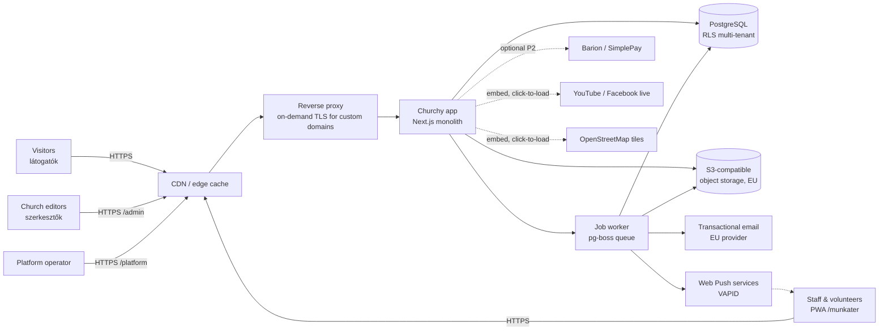
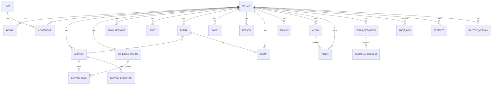
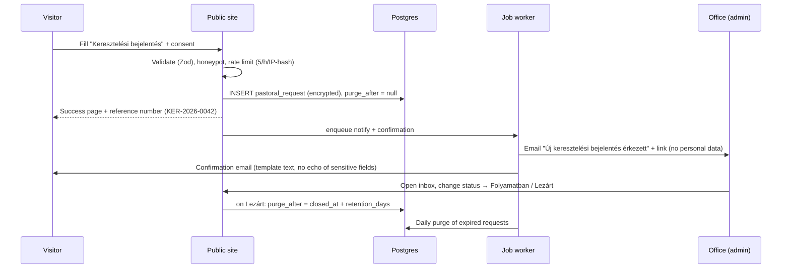
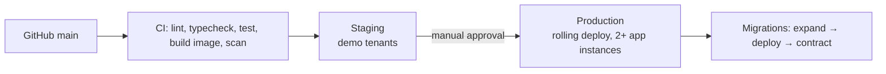
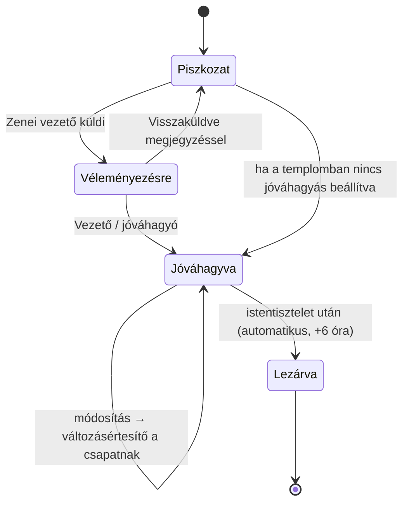
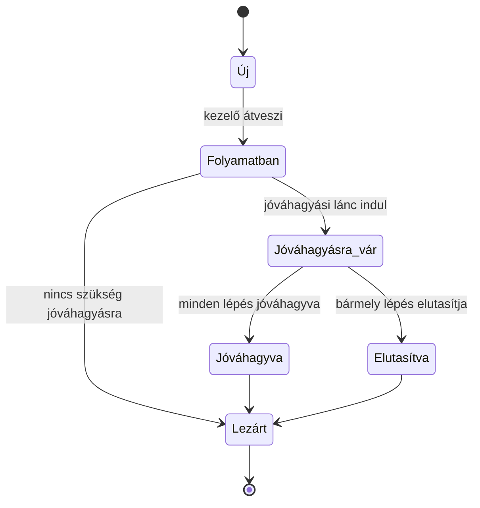
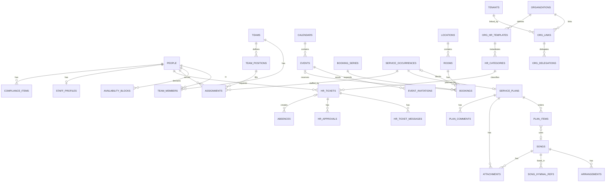

# Churchy — Solution Design Document (SDD)

| | |
|---|---|
| **Product** | Churchy — customizable website & internal workspace platform for Hungarian churches |
| **Document** | Solution Design Document |
| **Version** | 1.2 (draft) |
| **Date** | 2026-11-13 |
| **Changes in 1.2** | Diocesan HR portal (§25.7, RLS extension in §4.2); workspace plan tiers (§20.1); hymnal catalog without content (§24.2); parallel build: unified `people`/`events` schema from day one (ADR-16). |
| **Changes in 1.1** | Added Part B — internal workspace (*Munkatér*): §20–§28. Updated §1–§3, §8, §11, §17, §29 (repo), §30 (ADRs). |
| **Inputs** | [01-PRD.md](./01-PRD.md) |
| **Outputs** | [03-DELIVERABLES.md](./03-DELIVERABLES.md) |

Requirement IDs (`FR-…`, `NFR-…`, `L-…`, `C-…`) refer to the PRD.

---

## 1. Design principles

1. **Configuration, not code.** Every difference between churches is data: preset + overrides + theme tokens + module flags. No per-church branches or templates (G4).
2. **The schedule is the product.** The service-schedule engine is the most carefully designed, most tested component (FR-002, G2).
3. **Boring, proven technology.** One TypeScript monolith, one PostgreSQL database, one object store. Easy to run, cheap to host, easy to hire for.
4. **Server-rendered and cached.** Public pages are static-fast HTML regenerated on publish; JavaScript is an enhancement (NFR-01, NFR-09).
5. **Privacy by default.** No trackers, EU-only data, minimal personal data, special-category data isolated (NFR-06, C-03).
6. **Structured customization.** Curated themes and section blocks guarantee every site looks good and stays accessible, whatever the editor does (FR-104, NFR-04).
7. **One church, one model.** Website and workspace share the same people, events, locations and service schedule. Public vs internal is a *visibility* attribute, not a separate system (G10).
8. **Sensitive by category.** HR, health, safeguarding and pastoral data are encrypted at the application level, scoped by category and audit-logged on read (C-03, C-08, C-11).

The document has two parts: **Part A (§2–§19)** the platform and public website (R1); **Part B (§20–§28)** the internal workspace (R2).

## 2. System context



## 3. Technology stack

| Layer | Choice | Rationale |
|---|---|---|
| Language | **TypeScript** (strict) | One language front-to-back; typed config schemas. |
| Web framework | **Next.js (App Router)**, React Server Components | SSR + incremental static regeneration with tag-based revalidation; one app hosts public sites, admin and platform console. |
| Styling | **Tailwind CSS** + CSS custom properties for theme tokens | Themes swap tokens at runtime without rebuilds. |
| UI components (admin) | Radix UI primitives + own component library | Accessible primitives (focus management, ARIA). |
| Rich text | **Tiptap** (ProseMirror) storing JSON | Structured content, safe rendering, paste cleanup. |
| ORM / migrations | **Drizzle ORM** | SQL-first, typed, supports RLS-friendly raw SQL. |
| Database | **PostgreSQL 16** | RLS for tenant isolation, ICU collation `hu-HU`, built-in `hungarian` full-text config, `unaccent`. |
| Background jobs | **pg-boss** (Postgres-backed queue) | No extra infrastructure; email, image processing, retention purges, reminders. |
| Object storage | S3-compatible in an EU region | Media and PDFs; signed URLs for private files. |
| Image processing | **sharp** | Resize to AVIF/WebP + JPEG fallback, strip EXIF/GPS. |
| Auth | **Auth.js** (email magic link + password) + TOTP (otplib) | Simple for elderly users (magic link); 2FA for admins (FR-309). |
| Validation | **Zod** | Shared schemas for forms, API, config. |
| Email | Transactional provider with EU data residency, via SMTP/API adapter | Swappable. Templates in **React Email**, Hungarian. |
| Reverse proxy / TLS | **Caddy** with on-demand TLS (ask-endpoint validates domain against DB) | Automatic Let's Encrypt certificates for custom domains (FR-108). |
| CDN | EU-capable CDN in front of Caddy, caching public HTML and assets | Sunday-morning peaks (NFR-03). |
| Hosting | Containers (Docker) on EU infrastructure; managed Postgres with PITR | GDPR residency (NFR-06), backups (NFR-07). |
| Observability | Sentry-compatible error tracking (self-hosted or EU), OpenTelemetry traces, uptime monitor | NFR-12. |
| Testing | Vitest (unit), Playwright (E2E + visual), axe-core (a11y), k6 (load) | See §17. |
| PWA / offline (workspace) | **Serwist** service worker, Cache Storage + IndexedDB | Installable workspace, offline service plans (NFR-14). |
| Push | Web Push with VAPID (`web-push`) | No third-party push vendor; works on Android, desktop, iOS 16.4+ installed PWA. |
| Calendar UI | **FullCalendar** (MIT core) with Hungarian locale | Proven day/week/month/agenda views, resource timeline for rooms. |
| Documents & media (workspace) | **pdf.js** viewer, HTML5 audio with HTTP range requests | Inline preview of sheet music and reference recordings. |
| Chord charts | **ChordPro** format parsed with `chordsheetjs` | Transposition, capo, H/B note naming (L-11). |
| Booking integrity | PostgreSQL `btree_gist` **exclusion constraints** on `tstzrange` | Database-guaranteed no double booking (NFR-15). |
| CI/CD | GitHub Actions → container registry → staged rollout | |

## 4. Multi-tenancy

### 4.1 Tenant resolution

Every request is resolved to exactly one tenant (church) by host name:

```
request.host
  ├─ "<slug>.churchy.hu"           → tenant by slug
  ├─ custom domain (domains table) → tenant by domain (www. normalized, redirect to primary)
  ├─ "admin.churchy.hu"/... none    → platform routes only
  └─ unknown                        → 404 "Ez az oldal nem található"
```

Implemented in Next.js middleware: host → `tenantId` lookup (cached in-memory LRU, 60 s TTL, invalidated on domain change). The tenant id is placed in a request header consumed by server components and route handlers.

### 4.2 Data isolation

- Shared database, shared schema; **every tenant-owned table has `tenant_id uuid not null`**.
- **PostgreSQL Row-Level Security** on all tenant tables: `USING (tenant_id = current_setting('app.tenant_id')::uuid)`.
- The app connects as a non-owner role without `BYPASSRLS`; each request opens a transaction and runs `SET LOCAL app.tenant_id = …`. Platform-console queries use a separate role and are audit-logged.
- Object storage keys are prefixed `t/<tenant_id>/…`; private files (request attachments, PDFs of requests) are only served via short-lived signed URLs after a permission check.
- Automated test (D-03 in deliverables): for every tenant table, attempt cross-tenant read/write and assert failure.
- **Single exception — diocesan HR delegation (R2):** HR tables only (`hr_*`, `absences`, `leave_entitlements`, `staff_profiles`) carry an additional policy branch that admits a diocesan session (`app.org_id`) for rows of linked parishes in delegated categories. All other tables have no such branch, so a diocesan session cannot read them. Details in §25.7.

### 4.3 Caching per tenant

- Public pages are rendered with ISR and tagged `t:<tenantId>`, `t:<tenantId>:<module>`, `t:<tenantId>:<entity>:<id>`.
- On publish/update, the app calls `revalidateTag` for the affected tags and purges the CDN by surrogate key.
- The schedule pages and "next services" widget are additionally revalidated **hourly and at midnight Europe/Budapest** so "Ma / Holnap" labels stay correct without edits.

## 5. Customization model

All per-church differences live in one validated **SiteConfig** document plus content tables.

### 5.1 Configuration layering

```
effectiveConfig = deepMerge(
  platformDefaults,
  denominationPreset[tenant.denomination],   // terminology, modules, rites, serviceTypes, homeLayout
  tenant.siteConfig                          // church overrides (only stored diffs)
)
```

Only overrides are stored, so improvements to presets reach every church automatically.

### 5.2 SiteConfig schema (abridged, Zod-defined)

```ts
type SiteConfig = {
  identity: {
    name: string;                 // "Budapest-Belvárosi Nagyboldogasszony Főplébánia"
    shortName: string;            // "Belvárosi Plébánia"
    tagline?: string;
    logoMediaId?: string;
    faviconMediaId?: string;
  };
  denomination: 'rk' | 'gk' | 'ref' | 'ev' | 'bapt' | 'unit' | 'general';
  terminology: Partial<Record<TermKey, TermForms>>;   // overrides
  theme: {
    themeId: 'klasszikus' | 'letisztult' | 'kozossegi';
    colors: { primary: string; secondary: string; accent?: string };
    fontPairing: 'serif-classic' | 'humanist' | 'modern-sans';
    heroStyle: 'image-full' | 'image-split' | 'text-only';
    radius: 'none' | 'small' | 'large';
  };
  modules: Record<ModuleKey, boolean>;
  navigation: NavItem[];          // max depth 2
  home: HomeSection[];            // ordered
  footer: { showMap: boolean; links: NavItem[]; dioceseLink?: { label: string; url: string } };
  contact: { email?: string; phone?: string; officeHours: OfficeHours; };
  legal: ImpresszumData & PrivacyData;
  giving: { accountName?: string; accountNumber?: string; iban?: string;
            reference?: string; szja1TechnicalNumber?: string; foundationTaxNumber?: string;
            showQr: boolean };
  integrations: { youtubeChannelUrl?: string; facebookUrl?: string; instagramUrl?: string;
                  livestream?: { provider: 'youtube' | 'facebook' | 'other'; url: string } };
};
```

### 5.3 Terminology

Terms are stored with the grammatical forms the UI needs, so the UI never has to suffix a word at runtime:

```ts
type TermForms = {
  nom: string;        // "Miserend"        — headings, nav
  lower: string;      // "miserend"        — inside sentences
  slug: string;       // "miserend"        — URL segment
  plural?: string;    // "szentmisék"
  article: 'a' | 'az';// "a miserend", "az istentiszteleti rend"
};
```

Usage: `t.term('serviceSchedule').nom`. Message catalogs reference terms by placeholder, e.g. `"home.nextServices": "Következő {service.plural}"`. When a church overrides a term with a new slug, the old slug is stored in `redirects` and returns HTTP 301 (FR-102).

### 5.4 Themes

A theme = a set of design tokens + layout variants for a fixed set of components (header, hero, cards, footer). Themes never contain content.

| Token group | Examples |
|---|---|
| Color | `--c-primary`, `--c-primary-contrast`, `--c-surface`, `--c-text`, `--c-muted`, `--c-accent` |
| Typography | `--font-heading`, `--font-body`, scale steps `--fs-1…--fs-7` (base 17 px) |
| Shape | `--radius-sm/md/lg`, `--shadow-card` |
| Spacing | 4 px grid, `--space-1…--space-12` |

| Theme | Character | Fonts (self-hosted, latin-ext) |
|---|---|---|
| **Klasszikus** | Traditional, serif headings, cream background, gold/burgundy accents; suits historic churches. | Cormorant Garamond + Source Sans 3 |
| **Letisztult** | Minimal, lots of white space, single strong brand color; suits modern/urban congregations. | Inter + Inter |
| **Közösségi** | Warm, rounded cards, photo-forward; suits families/free churches. | Nunito + Nunito Sans |

All fonts are self-hosted with `latin-ext` subsets (ő, ű). Color pickers compute contrast in real time; a color whose contrast against its paired foreground is < 4.5:1 cannot be saved and the editor is shown the nearest passing shade (FR-103).

### 5.5 Modules

```ts
type ModuleKey = 'news' | 'announcements' | 'events' | 'schedule' | 'locations'
  | 'staff' | 'rites' | 'groups' | 'sermons' | 'livestream' | 'gallery' | 'documents'
  | 'giving' | 'onlineGiving' | 'massIntentions' | 'funeralNotices' | 'newsletter'
  | 'search' | 'liturgicalCalendar';
```

A module registry declares, per module: routes, admin menu entries, home sections it offers, nav item defaults, permissions it introduces, and sitemap contributions. Disabling a module hides all of these and returns 404 for its routes (content is preserved).

## 6. Information architecture (public site)

Default URL map (slugs shown for the Roman Catholic preset; term-driven slugs in *italics* change by preset):

| Route | Page | Module |
|---|---|---|
| `/` | Kezdőlap | core |
| `/`*`miserend`* | Service schedule (this week; `?datum=2026-12-24`; `?hely=<location>`) | schedule |
| `/hirdetesek` | Latest weekly announcements | announcements |
| `/hirdetesek/2026-11-15` | Announcements for the week of that Sunday | announcements |
| `/hirek`, `/hirek/<slug>` | News list / detail | news |
| `/esemenyek`, `/esemenyek/<slug>`, `/esemenyek/naptar` | Events list / detail / month view | events |
| `/esemenyek.ics` | iCal feed | events |
| `/templomaink/<slug>` | Location detail (title term-driven) | locations |
| `/munkatarsaink` | Clergy & staff | staff |
| `/kozossegeink`, `/kozossegeink/<slug>` | Groups | groups |
| `/`*`szentsegek`*`/<rite>` | Rite info page (e.g. `/szentsegek/keresztelo`; Reformed: `/alkalmak/keresztelo`) | rites |
| `/`*`szentsegek`*`/<rite>/bejelentes` | Request form | rites |
| `/`*`homiliak`*, `/…/<slug>`, `/…/podcast.xml` | Sermons | sermons |
| `/elo` | Livestream | livestream |
| `/galeria`, `/galeria/<album>` | Gallery | gallery |
| `/dokumentumok` | Documents | documents |
| `/tamogatas` | Support / giving | giving |
| `/kapcsolat` | Contact | core |
| `/kereses?q=` | Search | search |
| `/impresszum`, `/adatkezeles`, `/akadalymentesseg` | Legal pages | core |
| `/<page-slug>` | Static pages (Rólunk, Történetünk…) | core |
| `/sitemap.xml`, `/robots.txt` | SEO | core |

Default main navigation (≤ 7 items, preset-driven): **Kezdőlap · Miserend · Hirdetések · Események · Szentségek · Rólunk ▾ · Kapcsolat**, plus a prominent **Támogatás** button.

## 7. Page designs

### 7.1 Home page (Kezdőlap) — mobile first

```
┌──────────────────────────────────┐
│ [logo] Belvárosi Plébánia     ☰  │  sticky header, 56px
├──────────────────────────────────┤
│  ┌──────────────────────────────┐│
│  │  hero photo of the church    ││  hero (theme variant)
│  │  "Isten hozott!"             ││  tagline
│  └──────────────────────────────┘│
│ ● ÉLŐ  Most közvetítünk  ▶       │  only while a livestream is live
├──────────────────────────────────┤
│ KÖVETKEZŐ SZENTMISÉK             │  next-services card (always first
│ Ma, csütörtök                    │  below hero; cannot be removed when
│  18:00  Nagyboldogasszony-templom│  the schedule module is on)
│ Holnap, péntek                   │
│   7:00  Szent Anna-kápolna       │
│  18:00  Nagyboldogasszony-templom│
│  ⚠ Nov. 15-én a 10 órai mise    │  upcoming exception highlighted
│    8:30-kor kezdődik.            │
│ [Teljes miserend →]              │
├──────────────────────────────────┤
│ HETI HIRDETÉSEK  nov. 9–15.      │
│ • Szombaton 15 órakor …          │
│ [Elolvasom] [PDF ↓]              │
├──────────────────────────────────┤
│ HÍREK            [Összes →]      │
│ [img] Adventi koszorúkötés …     │  3 cards
├──────────────────────────────────┤
│ ESEMÉNYEK        [Naptár →]      │
│ NOV 20  Ifjúsági est  19:00      │  date-badge list (3–5)
├──────────────────────────────────┤
│ 📍 1056 Budapest, Március 15. tér │  map (click-to-load) + address
│ [Útvonaltervezés]                │  deep link to maps app
├──────────────────────────────────┤
│ footer: contact · office hours · │
│ Impresszum · Adatkezelés · social│
└──────────────────────────────────┘
```

Desktop (≥ 1024 px): two-column under the hero — left: next services + announcements; right: news + events. Max content width 1200 px.

### 7.2 Service schedule page (Miserend)

- Top: location filter chips (*Mind · Nagyboldogasszony-templom · Szent Anna-kápolna*) and a week switcher (`‹ Előző hét · Ez a hét · Következő hét ›`) plus a date picker.
- Body: one row per day `Hétfő, nov. 10.` → list of services `time · location · type badge · language badge · note`. Today highlighted; past services dimmed.
- Exceptions shown inline with a reason badge (*Elmarad*, *Változás*, *Rendkívüli*).
- Below: "Általános miserend" — the regular weekly table per location and season, with validity (*Érvényes: 2026. szeptember 1-jétől*).
- Print stylesheet: one-page weekly schedule suitable to post on the church door.

### 7.3 Announcements (Hirdetések)

- Heading `Hirdetések — 2026. november 15. (Évközi 33. vasárnap)` (liturgical day name from the calendar engine, preset-dependent).
- Rich text body; attached PDF shown with an inline viewer link and download button.
- Navigation: `‹ Előző hét | Archívum | Következő hét ›`.

### 7.4 Rite pages and request form

- Info page sections: *Mikor és hogyan?*, *Szükséges dokumentumok* (checklist), *Felkészítés*, *Díjak / adomány* (optional), *Kapcsolat* + **[Bejelentés indítása]** button.
- Form: progressive, single-column, large inputs; fields defined by `FormDefinition` (§8); a summary step before submit; privacy notice link and required consent checkbox; success page with what happens next (*„Irodánk 3 munkanapon belül felveszi Önnel a kapcsolatot.”*).
- Uses formal address (*Ön*) throughout.

### 7.5 Other pages (summary)

| Page | Key design points |
|---|---|
| News detail | Title, date (`2026. november 12.`), cover image with alt text, body, share buttons (Facebook, Messenger, copy link — no tracking scripts, plain share URLs), "Kapcsolódó hírek". |
| Event detail | Date/time block, location card with map link, recurrence description in Hungarian (*„Minden hónap első péntekén 18:00-kor”*), add-to-calendar (.ics, Google). |
| Staff | Grid of cards, grouped; email shown as obfuscated mailto, phone as `tel:` link. |
| Support | Account number with copy button, payment reference, QR code (instant payment), 1% section with technical/tax number and short explanation. |
| Contact | Office hours table with today highlighted and *„Most nyitva / Most zárva”* status; exceptions (*„Az iroda júl. 15–31. között zárva tart.”*); contact form. |

## 8. Domain & data model

### 8.1 Entity overview



### 8.2 Key tables (abridged)

| Table | Key columns |
|---|---|
| `tenants` | `id, slug, name, denomination, status(active/suspended), site_config jsonb, plan, created_at` |
| `domains` | `id, tenant_id, hostname unique, is_primary, verified_at, tls_status` |
| `users` | `id, email unique, name, password_hash?, totp_secret_enc?, last_login_at` |
| `memberships` | `user_id, tenant_id, role(owner/admin/editor/office/group_leader), group_ids uuid[]` |
| `locations` | `id, tenant_id, name, slug, kind(templom/kapolna/filia/egyeb), address jsonb, geo point, opening_hours jsonb, accessibility jsonb, photo_media_id, sort` |
| `schedule_periods` | `id, tenant_id, name ("Általános", "Nyári miserend"), valid_from date?, valid_to date?, recurrence(yearly bool), priority int` |
| `service_rules` | `id, tenant_id, period_id, location_id, weekday 1–7, nth_week? (e.g. 1 = first of month), time, duration_min, service_type, language, title?, note?, livestream bool` |
| `service_exceptions` | `id, tenant_id, location_id?, date, kind(cancel/add/modify), rule_id?, time?, service_type?, note, reason` |
| `announcements` | `id, tenant_id, week_sunday date unique per tenant, body jsonb, pdf_media_id?, status, published_at` |
| `posts` | `id, tenant_id, slug, title, lead, body jsonb, cover_media_id, categories text[], status, publish_at, expires_at?, search tsvector` |
| `events` | `id, tenant_id, calendar_id, visibility(private/team/staff/public), slug, title, body, starts_at, ends_at, all_day, rrule?, exdates date[], location_id?, group_id?, team_id?, category, cover_media_id, status, created_by` — one table for public and internal events (§22) |
| `pages` | `id, tenant_id, slug, title, blocks jsonb, parent_id?, status, seo jsonb` |
| `people` | `id, tenant_id, user_id? (login), prefix?, family_name, given_name, suffix?, role_title, group(clergy/staff/council/volunteer), is_public bool, bio, email?, phone?, contact_visibility jsonb, skills text[], photo_media_id, active, sort` — single person record for the public staff page **and** the workspace directory (§21) |
| `groups` | `id, tenant_id, slug, name, description, meeting_info, leader_person_id?, contact_email?` |
| `sermons` | `id, tenant_id, slug, title, preacher_person_id?, date, bible_ref, series?, audio_media_id?, external_url?, duration_s` |
| `media` | `id, tenant_id, kind(image/pdf/audio/other), storage_key, variants jsonb, width, height, bytes, alt, caption, people_consent bool, uploaded_by` |
| `form_definitions` | `id, tenant_id, key ("keresztelo"), title, fields jsonb, notify_emails text[], confirmation_text, retention_days` |
| `pastoral_requests` | `id, tenant_id, form_id, data_enc bytea, status(uj/folyamatban/lezart), assignee_id?, notes_enc?, consent_at, consent_text_hash, closed_at?, purge_after` |
| `content_versions` | `id, tenant_id, entity, entity_id, snapshot jsonb, author_id, created_at` |
| `audit_log` | `id, tenant_id?, actor_id, action, entity, entity_id, diff jsonb, ip_hash, at` |
| `redirects` | `tenant_id, from_path, to_path, code` |
| `newsletter_subscribers` (P2) | `id, tenant_id, email, confirmed_at, unsubscribe_token` |

All text columns used for sorting use collation `"hu-HU-x-icu"` (L-03). Search columns use `to_tsvector('hungarian', unaccent(...))` (L-09).

### 8.3 Pastoral request encryption

`pastoral_requests.data_enc` and `notes_enc` are encrypted at the application layer (AES-256-GCM, envelope encryption: per-tenant data key encrypted by a platform master key held in the secrets manager). Consequences:
- DB dumps/backups never contain plaintext religious data (C-03).
- Search over requests is limited to status/date/form type (by design).
- Purge job deletes rows where `purge_after < now()` daily and records the count (not content) in the audit log.

## 9. Service schedule engine

The engine turns rules + periods + exceptions into concrete services for any date range. It is a pure, framework-independent TypeScript module (`packages/schedule`) with exhaustive unit tests.

### 9.1 Algorithm

```
resolve(tenant, from, to, locationFilter?) -> Service[]:
  for each date d in [from, to] (Europe/Budapest):
    periods = activePeriods(d)                 # valid_from ≤ d ≤ valid_to (yearly periods match month-day)
    # per location: the active period with highest priority wins (e.g. "Nyári" > "Általános")
    for each location L:
      p = max(periods where p has rules for L, by priority)
      base = p.rules where rule.location = L
                         and rule.weekday = isoWeekday(d)
                         and (rule.nth_week is null or matchesNth(d, rule.nth_week))
      services += base.map(toService(d))
    apply exceptions for d in order: cancel → modify → add
    mark feast context: liturgicalDay(d, tenant.denomination), publicHoliday(d)
  return sorted by (date, time, location.sort)
```

### 9.2 Feast-aware defaults

- `packages/calendar` computes Western Easter (Gregorian computus) and derived moveable days: Hamvazószerda, Virágvasárnap, Nagycsütörtök, Nagypéntek, Nagyszombat, Húsvétvasárnap/-hétfő, Áldozócsütörtök (Ascension), Pünkösdvasárnap/-hétfő, Úrnapja (Catholic), Advent Sundays; and fixed Hungarian holidays (jan. 1., márc. 15., máj. 1., aug. 20., okt. 23., nov. 1., dec. 24–26.).
- Catholic preset adds the general Roman calendar's solemnities and Sunday naming (*Évközi 33. vasárnap*); Protestant presets use Sunday naming of the Protestant church year (e.g. *Szentháromság ünnepe utáni 23. vasárnap*), configurable per preset.
- **Holiday templates** (FR-312): e.g. "Nagyhét" generates editable exceptions for Nagycsütörtök–Húsvéthétfő for each location; "Karácsony" for Dec 24–26; "Szilveszter/Újév". Editors review a preview before applying.
- Warning rules for the dashboard: a public holiday or feast in the next 14 days with **no exceptions defined** → *„Jövő héten Mindenszentek ünnepe van. Ellenőrizte a miserendet?”*.

### 9.3 Display rules

- "Next services" widget: services from *now* to end of tomorrow; if none, the next 3 services within 14 days; labels *Ma*, *Holnap*, otherwise `Szombat, nov. 15.`.
- Services within the past 60 minutes show *„Most zajlik”* if a livestream is linked.
- All times computed in `Europe/Budapest` regardless of server TZ; DST transitions covered by tests.

## 10. Events & recurrence

- Recurrence uses RFC 5545 RRULE (via `rrule` library) with Hungarian human-readable rendering implemented in-house (`„Minden héten kedden és csütörtökön”`, `„Minden hónap utolsó vasárnapján”`).
- Expansion happens at read time for a bounded window (max 400 days); `exdates` cancel occurrences; single-occurrence overrides stored as child events with `recurrence_id`.
- iCal feed (`/esemenyek.ics`) and per-event `.ics` generated with `VTIMEZONE` Europe/Budapest.

## 11. Admin application

### 11.1 Structure

Served at `/admin` on each church's own domain (so cookies are first-party and scoped per domain), plus a platform console at `platform.churchy.hu`. Once the workspace (R2) is enabled, `/admin` appears as the **„Weboldal”** section inside the Munkatér navigation (§20) — same login and session.

```
Vezérlőpult (dashboard)
├─ Gyors feladatok: [Heti hirdetés] [Miserend-változás] [Új hír] [Új esemény]
├─ Figyelmeztetések (warnings)
└─ Új kérések (3)
Tartalom
├─ Hirdetések · Hírek · Események · Oldalak · Igehirdetések · Galéria · Dokumentumok
Miserend / Istentiszteleti rend
├─ Heti rend (periods & rules)  ├─ Kivételek  ├─ Ünnepi sablonok
Helyszínek · Munkatársak · Közösségek
Kérések (inbox)
Megjelenés
├─ Arculat (logo, colors, fonts) ├─ Téma ├─ Kezdőlap ├─ Menü ├─ Lábléc
Beállítások
├─ Általános ├─ Felekezet & szóhasználat ├─ Modulok ├─ Kapcsolat & nyitvatartás
├─ Támogatás ├─ Jogi adatok (Impresszum, Adatkezelés) ├─ Domain ├─ Felhasználók ├─ Napló
```

### 11.2 UX rules for non-technical editors (FR-301)

- Base font 17 px, touch targets ≥ 44 × 44 px, high-contrast admin theme.
- One primary action per screen; destructive actions require confirmation with the item name.
- Plain Hungarian labels (*„Közzététel”*, *„Mentés piszkozatként”*, *„Időzítés”*), contextual help text under each field, no technical terms (no "slug": *„Webcím”* with auto-generation).
- Autosave every 10 s with *„Mentve 12:04-kor”* indicator; leaving with unsaved changes warns.
- "Preview as visitor" opens the real page in draft mode (signed preview cookie).
- Weekly announcement flow: **3 steps** — (1) choose the week (defaults to the coming Sunday), (2) paste text or upload PDF, (3) Közzététel. PDF text is extracted to make it searchable.
- Schedule exception flow: pick date(s) → pick affected services from a list (generated by the engine) → *Elmarad / Időpont változik / Új alkalom* → note → preview of the week → save.

### 11.3 Roles & permissions matrix

| Capability | Tulajdonos | Adminisztrátor | Szerkesztő | Iroda | Csoportvezető |
|---|:-:|:-:|:-:|:-:|:-:|
| Manage users & roles | ✔ | ✔ (not owners) | | | |
| Domain, legal data, delete site | ✔ | | | | |
| Appearance, modules, navigation, terminology | ✔ | ✔ | | | |
| Pages, news, gallery, sermons, documents | ✔ | ✔ | ✔ | | |
| Announcements | ✔ | ✔ | ✔ | ✔ | |
| Schedule (rules & exceptions), locations, office hours | ✔ | ✔ | | ✔ | |
| Events | ✔ | ✔ | ✔ | ✔ | own group only |
| Group page | ✔ | ✔ | ✔ | | own group only |
| Pastoral requests (read/handle) | ✔ | ✔ | | ✔ | |
| Audit log | ✔ | ✔ | | | |

Permissions are checked server-side in a single `can(user, action, resource)` policy module; UI hides what a role can't do. Every policy has a unit test.

## 12. Request handling flow



## 13. Security design

| Area | Design |
|---|---|
| Authentication | Magic-link email (15-min single-use token) or password (Argon2id, breached-password check offline list); TOTP 2FA, mandatory for owner/admin; session cookie `HttpOnly; Secure; SameSite=Lax`, 30-day sliding expiry, revocable server-side sessions. |
| Authorization | Central policy module, server-side checks on every mutation; tenant enforced again by RLS (defense in depth). |
| Input/output | Zod validation; rich text stored as ProseMirror JSON and rendered via an allow-list renderer (no raw HTML); embeds restricted to an allow-list of providers (YouTube, Facebook, Vimeo, SoundCloud, OpenStreetMap). |
| Headers | Strict CSP with nonces, HSTS (preload for platform domain), `X-Content-Type-Options`, `Referrer-Policy: strict-origin-when-cross-origin`, `Permissions-Policy` minimal. |
| CSRF | Server Actions with origin checks; SameSite cookies. |
| Rate limiting | Login, magic link, forms, search (Postgres-backed token bucket keyed by hashed IP + tenant). |
| Uploads | MIME sniffing, size limits (images 20 MB, PDF 30 MB, audio 200 MB), images re-encoded (strips EXIF/GPS), PDFs served with `Content-Disposition` and from a separate cookieless media host. |
| Secrets | Secrets manager / environment injection, never in repo; master encryption key rotation procedure documented. |
| Custom domains | Caddy on-demand TLS asks `/api/tls-allow?domain=` which only approves verified domains (DNS TXT or CNAME check) — prevents certificate abuse. |
| Supply chain | Lockfile, Renovate, `npm audit`/OSV scan, container image scan, signed images. |
| Admin impersonation | Platform operators can only impersonate after the church owner grants time-limited support access; fully audit-logged. |

## 14. Privacy & compliance implementation

- **Impresszum generator** (C-01): structured fields in *Beállítások → Jogi adatok*; page rendered from a template including platform-operator/hosting data automatically.
- **Privacy notice generator** (C-02): template with sections (controller, purposes, legal bases, retention, processors, rights, NAIH complaint route); church fills controller data; processors list is injected by the platform. Version-hashed; consent records store the hash.
- **No-cookie default** (C-04): session cookies only on `/admin`. Public pages set no cookies. Embeds use a click-to-load facade (*„A videó megtekintéséhez kattintson. A YouTube sütiket helyezhet el.”*); consent remembered in `localStorage` per provider.
- **Analytics** (optional): self-hosted, cookieless (e.g. Plausible-style) aggregated page views; shown in the dashboard.
- **Data subject requests**: admin can search requests by reference number and delete; export of a single request.
- **Photo consent** (C-06): upload dialog asks *„Felismerhető személyek szerepelnek a képen? Rendelkezik a hozzájárulásukkal?”*; flag stored per image.

## 15. Performance, SEO & caching

- Public routes are statically rendered per tenant and cached at the CDN (`s-maxage=300, stale-while-revalidate=86400`); tag purge on publish makes updates visible in ≤ 60 s.
- Images: responsive `srcset`, AVIF/WebP, lazy-loading below the fold, explicit dimensions (no CLS); hero image preloaded.
- JS budget: ≤ 70 KB gzipped on public pages (mostly menu, lightbox, date picker as islands).
- Fonts: self-hosted, `font-display: swap`, subset `latin` + `latin-ext`.
- Structured data: `Church` (or `PlaceOfWorship`) with `address`, `geo`, `openingHoursSpecification`, `event` list; `Event` on event pages; `NewsArticle` on posts; `BreadcrumbList`.
- `sitemap.xml` per tenant; `hreflang="hu"`; `<html lang="hu">`.

## 16. Accessibility

- WCAG 2.1 AA as a hard requirement: semantic landmarks, skip link (*„Ugrás a tartalomra”*), visible focus, ARIA only where needed, all images require alt text or explicit "decorative", captions/transcripts field for sermons.
- Contrast enforcement in theme editor; theme tokens tested with automated contrast checks for every theme × curated palette.
- Respects `prefers-reduced-motion` and `prefers-color-scheme` (themes ship light variant; dark variant P2).
- Font-size control (A/A+/A++) on public sites for older visitors.
- Automated axe-core checks in CI on every route of the demo tenants; manual screen-reader pass (NVDA + VoiceOver) before GA.

## 17. Testing strategy

| Level | Scope | Tooling | Gate |
|---|---|---|---|
| Unit | Schedule engine, calendar/Easter, RRULE Hungarian rendering, terminology, permissions, formatting (dates, names, addresses, accounts), encryption | Vitest | ≥ 90 % coverage of `packages/schedule`, `packages/calendar`; ≥ 80 % domain overall |
| Integration | DB with RLS, server actions, job handlers | Vitest + Testcontainers Postgres | Cross-tenant isolation suite must pass |
| E2E | Critical journeys (visitor + editor) on each denomination demo tenant | Playwright | 100 % pass on main |
| Visual regression | Each theme × key pages × mobile/desktop | Playwright screenshots | Reviewed diffs |
| Accessibility | All public routes + admin core screens | axe-core, Lighthouse CI | 0 serious/critical violations; Lighthouse a11y ≥ 95 |
| Performance | Home, schedule, news detail | Lighthouse CI, WebPageTest profile "Moto G / 4G" | Perf ≥ 90, LCP ≤ 2.5 s |
| Load | Sunday peak simulation | k6 | 200 req/s, p95 < 500 ms uncached, error rate < 0.1 % |
| Usability | Editors aged 55+, visitors | Moderated sessions (5 + 5) | NFR-10, G2 targets |
| Concurrency (R2) | Room booking under parallel requests | Integration tests, 100 parallel conflicting inserts | Exactly 1 succeeds, 99 receive conflict |
| Workflow (R2) | Plan, booking and HR state machines; approval chains; leave-day calculation | Vitest, table-driven | Every allowed and forbidden transition tested |
| Offline (R2) | Stage view & downloaded plans | Playwright with network offline emulation | Plan + attachments open offline |
| Usability (R2) | Volunteers (incl. 14–18 and 65+), worship leaders, HR handlers | Moderated sessions (5 + 3 + 3) | G7, G8 targets |

Seed data: 3 demo tenants (Catholic multi-location parish, Reformed congregation, Baptist church) with realistic Hungarian content, used by E2E, visual and performance tests and for sales demos.

## 18. Deployment & operations



- **Environments:** local (Docker Compose: app, Postgres, MinIO, Mailpit, Caddy), staging, production.
- **Runtime:** ≥ 2 app containers behind Caddy, 1 worker container; managed PostgreSQL with PITR and daily logical backups to separate EU storage (NFR-07); object storage with versioning.
- **Migrations:** backwards-compatible expand/contract; zero-downtime.
- **Monitoring:** uptime check per primary domain (sample-based for large fleets), error tracking, Postgres metrics, queue depth, TLS expiry alerts, purge-job heartbeat.
- **Runbooks:** restore from backup, rotate master key, custom domain troubleshooting, tenant export/delete, incident response (GDPR 72-hour notification).

## 19. Church onboarding flow

1. Operator (or self sign-up, later) runs **Új egyház** wizard: name, denomination, town/address, owner email, subdomain → tenant created with preset config and sample content flagged *„Mintatartalom”*.
2. Owner receives invitation (magic link) → lands on **onboarding checklist**:
   1. Logó és színek (2 min)
   2. Helyszínek és címek (3 min)
   3. Miserend / istentiszteleti rend (15–30 min, guided by weekly grid)
   4. Kapcsolat és irodai nyitvatartás (5 min)
   5. Munkatársak (10 min)
   6. Jogi adatok — Impresszum & Adatkezelés (10 min)
   7. Első hirdetés / hír (5 min)
   8. Mintatartalom törlése (1 click)
   9. Domain beállítása (optional; DNS instructions in Hungarian with registrar-specific tips)
3. Checklist progress shown on dashboard; the site shows a discreet *„Hamarosan”* banner until the owner presses **Oldal élesítése**.

---

# Part B — Internal workspace (*Munkatér*, R2)

## 20. Workspace overview

### 20.1 Placement

- Same Next.js app, same tenant resolution (§4) and same login, at **`https://<church-domain>/munkater`**. The website CMS (`/admin`) becomes the *Weboldal* section inside it for users with website roles.
- Workspace modules are tenant-level flags (plan-dependent), parallel to the website modules in §5.5:

```ts
type WorkspaceModuleKey = 'ws.calendar' | 'ws.rooms' | 'ws.worship' | 'ws.rota'
  | 'ws.hr' | 'ws.hr.leave' | 'ws.hr.confidential' | 'ws.docs' | 'ws.board';
```

- **Plan tiers:** the workspace is a flat-priced add-on per church (PRD §14.1). `tenants.ws_tier` (`none / s50 / m150 / l300`) enables the workspace modules and caps active workspace users; inviting beyond 90 % shows a Hungarian warning, at 100 % new invitations are blocked (deactivated users don't count).
- Workspace pages are dynamic, never CDN-cached, `Cache-Control: private, no-store` except static assets; served with `X-Robots-Tag: noindex`.

### 20.2 Navigation (mobile bottom bar / desktop sidebar)

**Ma · Naptár · Szolgálatok · Termek · Kérések** · *Továbbiak ▾* (Emberek, Dokumentumok, Értesítések, Profilom, Weboldal, Beállítások). Items the user can't use or modules that are off are hidden.

### 20.3 „Ma” (Today) home

```
┌──────────────────────────────────┐
│ Munkatér          🔔3   [KJ]     │
├──────────────────────────────────┤
│ Jó reggelt, János!               │
│ Csütörtök, november 13.          │
├──────────────────────────────────┤
│ TEENDŐK (2)                      │
│ ▸ Vasárnap 10:00 – gitár         │
│   [Elfogadom] [Nem tudok]        │
│ ▸ Énekrend véleményezése: vas.   │
│   10:00 szentmise  [Megnyitom]   │
├──────────────────────────────────┤
│ MA                               │
│ 17:00–18:30 Kórusterem – Próba   │
│ 18:00 Szentmise · Templom        │
├──────────────────────────────────┤
│ EZEN A HÉTEN                     │
│ Vas 10:00 Szentmise – gitár ✓    │
│   Énekrend: Jóváhagyva · 6 ének  │
│   📎 8 melléklet [Offline ⬇]     │
├──────────────────────────────────┤
│ KÉRÉSEIM                         │
│ HR-2026-0012 Szabadság – Folyamatban│
├──────────────────────────────────┤
│ [+ Terem foglalása] [+ Kérés]    │
└──────────────────────────────────┘
 Ma | Naptár | Szolgálatok | Termek | Kérések
```

Sections appear only when they have content; for a leader, an *Jóváhagyásra vár* (awaiting my approval) block appears at the top.

## 21. People, teams & workspace roles

### 21.1 Model

- **`people`** (§8.2) is the single person record. `user_id` links a login; people without a login (children, some elderly volunteers) are managed by their team leader and receive nothing directly (or via a guardian/contact email if configured).
- **`teams`**: `id, tenant_id, name, kind(music/liturgy/tech/facility/youth/other), description, calendar_id?`.
- **`team_members`**: `team_id, person_id, is_leader, positions uuid[], max_assignments_per_month?, notes`.
- **`team_positions`**: `id, team_id, name ("Ének", "Gitár", "Orgona", "Hangtechnika", "Vetítés", "Lektor 1. olvasmány"…), sort, min_count, max_count`.
- **`availability_blocks`**: `person_id, period tstzrange, recurring rrule?, note` — self-declared unavailability (*„Nem érek rá”*).

### 21.2 Workspace roles & permissions

Memberships get an additional `ws_roles text[]` and optional scopes (`team_ids`, `room_ids`, `hr_category_ids`). Roles are additive with the website roles of §11.3.

| Capability | Vezető | Munkatárs | Önkéntes | Csapatvezető | Zenei vezető | Teremfelelős | HR-felelős | Bizalmas ügyek kezelője |
|---|:-:|:-:|:-:|:-:|:-:|:-:|:-:|:-:|
| See directory (respecting contact visibility) | ✔ | ✔ | own teams | ✔ | ✔ | ✔ | ✔ | ✔ |
| Create staff-visible / team events | ✔ | ✔ | | own team | ✔ | ✔ | | |
| Publish events to the website (`public`) | ✔ | | | | | | | |
| Book rooms (subject to room policy) | ✔ | ✔ | if allowed by room | ✔ | ✔ | ✔ | | |
| Approve bookings | ✔ | | | | | scoped rooms | | |
| Create/edit service plans | ✔ | | | own team | ✔ | | | |
| Approve service plans | ✔ | | | | ✔ (if configured) | | | |
| Assign people to positions | ✔ | | | own team | ✔ | | | |
| Song library edit | ✔ | | | | ✔ | | | |
| View plans & attachments | ✔ | assigned | assigned / own team | own team | ✔ | | | |
| Submit HR requests | ✔ | ✔ | enabled categories | ✔ | ✔ | ✔ | ✔ | ✔ |
| Approve as manager | direct reports | direct reports | | | | | | |
| Handle HR tickets | | | | | | | scoped categories | |
| Handle confidential tickets | | | | | | | | scoped categories |
| Staff records, balances, payroll export | | | | | | | ✔ | |

`can()` (§11.3) is extended with resource scopes. Every cell is unit-tested. Diocesan roles (*Egyházmegyei HR-admin, HR-ügyintéző, Bizalmas ügyek kezelője*) are **organization** roles, not tenant roles; they are defined in §25.7 and have no capability outside delegated HR.

## 22. Internal calendars

### 22.1 One events table, many layers

- All human-created events — public and internal — live in **`events`** with `calendar_id` and `visibility`. The public website queries `visibility = 'public' AND status = 'published'` only (tested with a negative test per visibility level).
- **`calendars`**: `id, tenant_id, name, color, kind(shared/team/personal/absence), owner_person_id?, team_id?, default_visibility, editors (role/team scopes)`.
- **Computed layers** are merged at read time, never copied:

| Layer | Source | Visible to |
|---|---|---|
| Services | Schedule engine (§9) | everyone |
| Room bookings | `bookings` (§23) | everyone (title only for others' private bookings) |
| My assignments | `assignments` (§24) | the person, team leaders |
| Absences | `absences` (§25) | everyone as *„Távol”*; type/reason only to HR handlers |

```
GET /munkater/api/calendar?from=…&to=…&layers=events,services,bookings,absences,assignments&calendars=…
→ permission-filter events → expand RRULE (§10) → merge computed layers → sort
```

### 22.2 Invitations, reminders, feeds

- **`event_invitations`**: `event_id, person_id | team_id, response(pending/yes/no/maybe), responded_at`. Team invitations expand to members at send time.
- **Reminders**: `event_reminders(event_id, offset_minutes, channel)` + user defaults; scheduled as pg-boss jobs on create/update, rescheduled on change.
- **Personal iCal feed**: `/munkater/ical/<token>.ics`. Token = 32 random bytes, stored as SHA-256 hash, revocable/regenerable in *Profilom*. Contains only what the user may see; option *„Részletek elrejtése”* exports busy blocks only.
- Two-way sync (P2) is out of scope for R2 GA; the design keeps `events.external_ref` for a later CalDAV/Graph adapter.

## 23. Room & resource booking

### 23.1 Data model

| Table | Key columns |
|---|---|
| `rooms` | `id, tenant_id, location_id, name, kind(room/resource), capacity?, features text[], photos, accessibility jsonb, manager_person_ids uuid[], approval_policy jsonb, rules jsonb, active` |
| `bookings` | `id, tenant_id, room_id, period tstzrange, buffer_before_min, buffer_after_min, blocked_period tstzrange GENERATED, status(pending/approved/rejected/cancelled), series_id?, event_id?, service_occurrence_id?, team_id?, title, purpose, attendees int?, setup_notes, requested_by, decided_by?, decided_at?, hold_expires_at?, source(user/service/external)` |
| `booking_series` | `id, tenant_id, room_id, rrule, dtstart, duration, …same descriptive fields` |
| `external_booking_requests` (P2) | `id, booking_id, requester_enc bytea, fee_info, consent_at` |

**Conflict guarantee (NFR-15):**

```sql
CREATE EXTENSION IF NOT EXISTS btree_gist;
ALTER TABLE bookings ADD CONSTRAINT bookings_no_overlap
  EXCLUDE USING gist (room_id WITH =, blocked_period WITH &&)
  WHERE (status IN ('pending', 'approved'));
```

The application catches the exclusion violation (`23P01`) and returns a structured conflict with the clashing booking (title hidden if not visible to the user) plus **alternatives**: rooms in the same location with capacity ≥ attendees and required features free in that slot, and the same room's nearest free slots ±3 hours / next 3 days.

### 23.2 Policies & rules

```ts
type ApprovalPolicy = {
  autoApprove: { roles?: WsRole[]; teamIds?: string[] };   // others → pending
  approvers: 'room_managers' | { personIds: string[] };
  holdHours: number;                                       // pending expires → cancelled
};
type BookingRules = {
  bookableHours?: WeeklyHours;  minNoticeHours?: number;  maxDurationMin?: number;
  horizonDays?: number;         blackout?: { name: string; from: string; to: string }[];
  whoCanRequest: WsRole[] | 'all_staff' | 'all_workspace';
};
```

### 23.3 Recurring bookings

- Series are expanded into concrete `bookings` rows for a rolling **12-month** horizon (nightly job extends). On creation, each occurrence is inserted in one transaction with per-row savepoints; the user sees a conflict list (*„52 alkalomból 3 ütközik”*) and chooses *ütközők kihagyása* or *mégsem*.
- Editing *„csak ezt / ezt és a következőket / az összeset”* follows calendar conventions.

### 23.4 Services auto-block rooms

- Config maps `(location, service_type)` → `room_ids` with buffers (e.g. Szentmise in Templom blocks *Templomtér* −30/+15 min).
- A nightly job (and a trigger after schedule edits) materializes `source='service'` approved bookings for 12 months from the schedule engine and removes stale ones. If a service block overlaps an existing user booking, the exclusion constraint rejects it; **nothing is cancelled automatically**. The clash is stored in `booking_conflicts(service_occurrence_id, booking_id, detected_at, resolved_at)`, the room manager is notified, and the job retries the service block once the user booking is moved or cancelled. Conversely, new user bookings can never overlap an existing service block.

### 23.5 Facility daily list

pg-boss cron 06:30 Europe/Budapest: per room manager / caretaker, email + in-app list of today's bookings with setup notes, attendees, and unlock times. Usage report = SQL aggregate over approved bookings → CSV.

## 24. Worship & music planning

### 24.1 Service occurrences

The schedule engine produces *virtual* services. Anything attached to a specific service (plan, assignments, room block) needs a stable id, so occurrences are **materialized lazily**:

- **`service_occurrences`**: `id, tenant_id, location_id, starts_at, service_type, rule_id?, exception_id?, status(scheduled/cancelled/moved), moved_to_id?` — unique `(tenant_id, location_id, starts_at, service_type)`.
- Created when first needed (plan, assignment, booking) and by a nightly job for the next **8 weeks**.
- When a schedule change cancels/moves a materialized occurrence, its status is updated and the plan owner + assigned team are notified (*„A vasárnap 10:00-s szentmise 8:30-ra került át — az énekrend és a beosztás áthelyezése szükséges.”*) with a one-click *Áthelyezés* action.
- Plans and assignments can alternatively attach to an `event` (concert, youth night).

### 24.2 Data model

| Table | Key columns |
|---|---|
| `hymnals` | `id, tenant_id? (null = platform catalog), abbreviation ("ÉE", "RÉ", "EÉ"), name, denomination?` — the platform catalog holds **names/abbreviations only, no songs**; songs come from manual entry or CSV import (`title; hymnal; number; first_line; default_key; tempo; themes`) with a validation report |
| `songs` | `id, tenant_id, title, alt_titles text[], first_line, lyrics text?, language, authors, composers, translators, copyright_holder, licence(public_domain/licensed/permission/own/unknown), licence_ref?, themes text[], seasons text[], default_key, tempo_bpm?, time_signature?, notes, search tsvector` |
| `song_hymnal_refs` | `song_id, hymnal_id, number, verses_note?` |
| `arrangements` | `id, song_id, name, key, tempo_bpm?, structure text, chordpro text?, notes` |
| `attachments` | `id, tenant_id, owner_type(song/arrangement/plan/plan_item), owner_id, media_id?, url?, kind(sheet_music/chord_chart/lyrics/audio/musicxml/image/link/other), label, part?("Szoprán", "Gitár"), key?, version int, supersedes_id?, rights_confirmed_by, created_at` |
| `plan_templates` | `id, tenant_id? (null = preset), denomination?, service_type, name, items jsonb` |
| `service_plans` | `id, tenant_id, occurrence_id? / event_id?, title, status(draft/in_review/approved/locked), template_id?, leader_person_id, approved_by?, approved_at?, approved_snapshot jsonb?, locked_at?, notes` |
| `plan_items` | `id, plan_id, position, type(song/liturgy/reading/prayer/sermon/announcement/other), title, song_id?, arrangement_id?, key_override?, verses?, duration_s?, responsible_person_id?, notes` |
| `assignments` | `id, tenant_id, occurrence_id? / event_id?, plan_id?, team_id, position_id, person_id, status(requested/accepted/declined/swap_requested/cancelled), requested_by, responded_at?, decline_reason?, swap_with_person_id?` |
| `plan_comments` | `id, plan_id, item_id?, author_id, body, mentions uuid[], resolved_at?` |
| `song_usages` | `song_id, plan_id, occurrence_date, arrangement_id?` — written when a plan is locked |

### 24.3 Plan workflow



- On approval, `approved_snapshot` is stored; later edits produce a **diff** (added/removed/reordered items, key changes, new attachments) sent to the team as one batched notification (debounced 10 min).
- Locking writes `song_usages` and makes the plan read-only.
- Templates come from presets (examples in PRD FR-802), copied into a new plan; liturgical items can carry default texts or hymnal suggestions per season (e.g. Advent).

### 24.4 Scheduling engine

Ranking candidates for `(occurrence, position)`:

1. **Hard filters** — member of the team with this position; not inactive; no approved absence or availability block overlapping the occurrence (+ rehearsal, if linked); not already assigned at an overlapping time.
2. **Soft score** — fewer assignments in the last 8 weeks (fairness), below personal monthly maximum, preferred positions, not assigned the previous week (configurable).
3. Leader sees top candidates with reasons (*„3 hete nem szolgált”*, *„Aznap már lektor”*) and can bulk-assign a month.

Requests are sent with **signed one-tap links** (`/munkater/v/<token>`; HMAC, 14-day expiry, single purpose) so volunteers can accept/decline from email without logging in; a decline asks for an optional reason and notifies the leader. Swap requests notify eligible substitutes; first acceptance wins (row-level lock).

Generic rotas (FR-812) use the same `assignments` without a plan.

### 24.5 Attachments & copyright

- Stored in the private bucket under `t/<tenant>/ws/attachments/…`; served only via **5-minute signed URLs** after `can(user, 'view', attachment)`: assigned people of the plan, members of the owning team, music leads, leaders. Never linked from public pages, never in sitemaps, `noindex`.
- Upload dialog requires *„Jogosult vagyok megosztani ezt a fájlt a csapattal”* (C-10); `rights_confirmed_by` stored. Takedown: operator can disable an attachment platform-wide by hash.
- Versioning: a new upload with the same label supersedes the previous one; history kept; plan shows the newest by default.
- Preview: pdf.js for PDF, `<audio>` with range requests for MP3/M4A, image viewer, ChordPro rendered to HTML. Max sizes: PDF 30 MB, audio 50 MB, MusicXML 10 MB.

### 24.6 Chord charts & transposition

- ChordPro parsed with `chordsheetjs`; rendering in the selected key with optional capo; note naming per user setting (**H/B Hungarian default**, L-11) — e.g. English `B` ↔ Hungarian `H`, English `B♭` ↔ Hungarian `B`.
- Rendered output is also available as PDF (server-side, same template as plan export).

### 24.7 Stage & rehearsal view, offline

- Route `/munkater/szolgalatok/<plan>/szinpad`: full-screen, dark background, large type, swipe/arrow keys/foot-pedal (keyboard events from Bluetooth pedals) to move between items, next-item preview, per-item attachment switcher.
- *„Letöltés offline használatra”* stores the plan JSON in IndexedDB and attachments in Cache Storage (checks `navigator.storage.estimate()`; warns above 200 MB). On reconnect the client compares `plan.updated_at` and shows *„A terv megváltozott”* with the diff.

## 25. HR request management

### 25.1 Data model

| Table | Key columns |
|---|---|
| `hr_categories` | `id, tenant_id, key, name, fields jsonb, who_can_submit(employees/volunteers/all), handler_scope, approval_chain jsonb, sla_hours?, confidential bool, creates_absence bool, absence_type?, retention_days, active` |
| `hr_tickets` | `id, tenant_id, reference ("HR-2026-0012"), category_id, requester_person_id, subject_enc, data_enc, status, current_step int, assignee_id?, due_at?, confidential bool, closed_at?, purge_after?` |
| `hr_ticket_messages` | `id, ticket_id, author_id, body_enc, internal bool, attachment_media_ids uuid[], created_at` |
| `hr_approvals` | `id, ticket_id, step, approver_id, decision(approved/rejected/delegated), comment_enc?, decided_at` |
| `absences` | `id, tenant_id, person_id, period daterange, half_day_start bool, half_day_end bool, type, working_days numeric, ticket_id?, status` |
| `leave_entitlements` | `person_id, year, days_total, carried_over, adjustments jsonb, note` |
| `staff_profiles` | `person_id, position, employment_type(munkaviszony/egyhazi_szolgalati/megbizasi/onkentes), start_date, end_date?, manager_person_id?, weekly_hours, work_pattern jsonb` |
| `staff_documents` | `id, person_id, media_id, kind(contract/job_description/other), restricted bool` (file encrypted) |
| `compliance_items` | `id, person_id, kind ("Erkölcsi bizonyítvány", "Önkéntes szerződés", "Gyermekvédelmi képzés"), verified_at, verified_by, expires_at?` — **no document stored** (C-12) |
| `checklists`, `checklist_tasks` | onboarding/offboarding templates and instances with assignee and due date |
| `workday_calendar` | platform-maintained: `date, kind(holiday/swapped_workday/swapped_restday), name` (L-12) |

`*_enc` columns use the per-tenant envelope encryption of §8.3. HR attachments are encrypted before upload (AES-GCM, key from the tenant data key) and stored in a separate prefix.

### 25.2 Ticket workflow & approval chains



```ts
type ApprovalStep =
  | { kind: 'manager' }                       // requester's staff_profiles.manager_person_id
  | { kind: 'person'; personId: string }
  | { kind: 'role'; role: 'Vezető' | 'HR-felelős'; any: true };
```

Resolution rules: a step whose approver is the requester is skipped to the next step; an approver with an approved absence covering today is auto-delegated to the configured deputy (logged); a step with no resolvable approver goes to the HR handler.

Leave categories may skip *Folyamatban* (auto-route straight to the approval chain).

### 25.3 Leave calculation

```
workingDays(person, from, to, halfDays) =
  Σ days d in [from, to]
    where person.work_pattern includes weekday(d)          // e.g. sacristan: Tue–Sun
      and workday_calendar[d] != holiday
      or  workday_calendar[d] == swapped_workday and pattern is Mon–Fri
  − 0.5 per half day
```

- The platform operator maintains `workday_calendar` yearly (public holidays + *áthelyezett munkanapok*); automated test covers each year's published list.
- On approval: `absences` row created, calendars show *Távol* (FR-608), entitlement used is recomputed, and **assignment conflicts** (accepted assignments overlapping the absence) are listed for the requester's team leaders with a *Helyettes keresése* action.
- Balance = entitlement + carry-over + adjustments − Σ approved working days of type *rendes szabadság*. The system **suggests** the statutory entitlement from age/children inputs only if HR enables it; HR always confirms.

### 25.4 Confidential tickets & safeguarding

- Categories with `confidential = true` are visible only to people with *Bizalmas ügyek kezelője* scoped to that category (plus the requester). Not visible to *Vezető* by default, not reachable by platform impersonation (hard-excluded in the policy module).
- Opening a confidential ticket requires entering a reason (*„Betekintés oka”*); each read is written to `audit_log` (NFR-17).
- An optional **anonymous** mode for complaints stores no requester identity; replies go through a one-time access code shown at submission.
- *Átadás* (handover) records the external body, date and what was handed over; the ticket becomes read-only.

### 25.5 Notifications & SLA

- Emails never contain ticket content: *„Új HR-kérés érkezett: HR-2026-0012 (Szabadságkérelem). Megtekintés: …”*.
- `due_at` computed from `sla_hours` in working hours (08:00–16:00 on working days by default); reminder at 75 % and at overdue to assignee and HR lead.
- HR dashboard: counts by status/category, overdue list, median resolution time per category.

### 25.6 Payroll export

Monthly CSV (UTF-8 with BOM for Excel, `;` separator — Hungarian Excel default): `Név; Adóazonosító (optional, if HR stored it); Típus; Kezdete; Vége; Munkanapok`. Column mapping configurable per tenant to match their payroll provider.

### 25.7 Diocesan HR portal

**Model**

| Table | Key columns |
|---|---|
| `organizations` | `id, kind(egyhazmegye/egyhazkerulet/egyeb), name, slug, denomination, settings jsonb` — platform-level, not a tenant |
| `org_memberships` | `org_id, user_id, roles(org_hr_admin/org_hr_handler/org_confidential_handler), category_scopes text[]?, parish_scopes uuid[]?` |
| `org_links` | `org_id, tenant_id, status(requested/active/revoked), requested_by, approved_by_parish, approved_by_org, linked_at, revoked_at` |
| `org_delegations` | `org_id, tenant_id, hr_category_key | '*'` — which HR categories the parish delegates |
| `org_hr_templates` | `id, org_id, key, version, definition jsonb` — pushed into parishes' `hr_categories` (`template_id, template_version` columns) |

`staff_profiles` gets `employer(parish/org)`; employees of the diocese serving in a parish are stored in the parish tenant with `employer = org`.

**Access enforcement (RLS)**

```sql
-- HR tables only; e.g. hr_tickets
CREATE POLICY hr_tenant_or_delegated ON hr_tickets USING (
  tenant_id = nullif(current_setting('app.tenant_id', true), '')::uuid
  OR EXISTS (
    SELECT 1 FROM org_links l
    JOIN org_delegations d ON d.org_id = l.org_id AND d.tenant_id = l.tenant_id
    JOIN hr_categories c   ON c.id = hr_tickets.category_id
    WHERE l.org_id = nullif(current_setting('app.org_id', true), '')::uuid
      AND l.tenant_id = hr_tickets.tenant_id AND l.status = 'active'
      AND (d.hr_category_key = '*' OR d.hr_category_key = c.key)
  )
);
```

- A diocesan request sets `app.org_id` and **no** `app.tenant_id`; therefore every non-HR table returns zero rows by construction.
- Confidential categories additionally require the `org_confidential_handler` role (application policy) and a read reason, as in §25.4.
- Encryption: ticket data stays encrypted with the **parish's** tenant data key; the portal decrypts per row after the policy check. Revoking a link takes effect immediately (no copies are made).
- Every diocesan read and action is written to the parish's `audit_log` with `actor_org_id`, so the parish owner can see what the diocese accessed.

**Linking flow**

1. Diocesan admin invites a parish (or the parish requests linking) → `org_links.status = requested`.
2. Parish owner approves and chooses delegated categories (default: all HR categories created from diocesan templates).
3. Diocesan templates are applied to the parish; the parish can't edit template-owned fields, only add its own categories.
4. Unlinking by either side → `revoked`; open delegated tickets are returned to the parish HR handler with a notification.

**Portal UI** — served at `https://<org-slug>.churchy.hu/egyhazmegye` (own domain possible):

- *Áttekintés*: tickets by parish/category/status, overdue list, median resolution time, approvals waiting.
- *Kérések*: unified inbox across parishes with a *Plébánia* filter; same ticket UI as §25.2.
- *Távollétek*: absence calendar across parishes (no reasons shown except to handlers of that category).
- *Sablonok*: HR category templates with versioning.
- *Jelentések*: leave balances, SLA, payroll CSV across parishes (extra `Plébánia` column).
- *Plébániák*: link status and delegated categories per parish.

Diocesan users authenticate with mandatory 2FA; one login can also hold normal tenant memberships (e.g. a diocesan HR officer who sings in their own parish's choir), but sessions are context-switched explicitly (*Egyházmegye ↔ Plébánia*) and never combine `app.org_id` and `app.tenant_id`.

## 26. Notifications & PWA

### 26.1 Notification service

- **`notifications`**: `id, tenant_id, user_id, kind, payload jsonb (no sensitive content), link, created_at, read_at`.
- **`notification_prefs`**: `user_id, kind, channels(in_app/email/push), digest(bool)`; sensible defaults per kind (assignment requests: push + email; plan changes: push; daily digest off).
- **`push_subscriptions`**: `user_id, endpoint, keys, ua, created_at, last_success_at` (pruned on 404/410).
- Fan-out through pg-boss; per-user batching window 2–10 min for noisy kinds (plan edits, comments); **quiet hours** 22:00–07:00 hold non-urgent pushes until morning.

| Kind | Default channels |
|---|---|
| Assignment request / reminder (3 days, 1 day before) | push + email |
| Plan sent for review / approved / changed after approval | push (+ email for leaders) |
| Booking requested / decided / conflict | push + email |
| HR ticket update (no content) | email + in-app |
| Event invitation / reminder | push |
| Daily facility list | email |

### 26.2 PWA

- Per-tenant `manifest.webmanifest` (name = church short name + „Munkatér”, icons generated from the logo, theme colour from the site theme), `scope: /munkater/`, `start_url: /munkater/ma`.
- Service worker: precache app shell; `NetworkFirst` for API with 3 s timeout fallback to cache for *Ma* and *Naptár*; on-demand cache for downloaded plans (§24.7).
- iOS: push requires installation to the home screen (iOS 16.4+); the app shows a Hungarian install guide on iOS Safari.

## 27. Workspace data model overview



All tables carry `tenant_id` and RLS policies (§4.2); the isolation suite (D-03) automatically covers them.

## 28. Workspace security & privacy

| Topic | Design |
|---|---|
| Authentication | Same as §13; **2FA mandatory** for *Vezető, HR-felelős, Bizalmas ügyek kezelője* and tenant owners/admins. Volunteers may stay on magic links. Idle timeout 30 min for HR screens. |
| Authorization | Extended `can()` with team/room/category scopes; HR and confidential checks are separate policy functions with their own exhaustive tests. |
| Encryption | App-level encryption (§8.3) for HR ticket content, messages, approval comments, HR attachments, staff documents, external rental requester data. |
| Retention | Per HR category `retention_days` after closure; staff documents and profiles: configurable period after `end_date`; volunteer compliance facts: deleted on deactivation + configurable period; purge job as in §8.3. Defaults reviewed by a lawyer (C-08). |
| Support access | Platform impersonation excluded from `ws.hr*` routes and data entirely. |
| Diocesan access | RLS branch for HR tables only (§25.7); two-sided linking approval; reads logged into the parish audit log; mandatory 2FA; isolation suite extended with diocesan sessions (must read 0 rows from every non-HR table and from non-delegated categories). |
| Audit | Confidential reads (with reason), HR approvals, role changes, staff-document downloads, attachment takedowns. |
| Copyright | §24.5: internal-only attachments, rights confirmation, takedown, usage reports. |
| Privacy notices | Templates for the employee and volunteer privacy notices (C-09) generated like the public notice (§14), shown at first workspace login with acknowledgement stored. |
| Minors | Volunteers under 18 flagged; their contact details hidden from non-leaders by default; communication to guardian email if configured. |

## 29. Repository structure

```
churchy/
├─ apps/
│  └─ web/                    # Next.js: public sites, /admin, platform console
│     ├─ app/(public)/…
│     ├─ app/admin/…
│     ├─ app/munkater/…       # workspace (R2): ma, naptar, szolgalatok, termek, keresek…
│     ├─ app/egyhazmegye/…    # diocesan HR portal (R2)
│     ├─ app/platform/…
│     └─ middleware.ts        # tenant resolution
├─ packages/
│  ├─ schedule/               # pure schedule engine
│  ├─ calendar/               # Easter, feasts, Hungarian holidays, liturgical day names
│  ├─ hu/                     # formatting: dates, names, addresses, accounts, slugs, a/az
│  ├─ presets/                # denomination presets (terminology, modules, rites, forms)
│  ├─ themes/                 # tokens + component variants
│  ├─ db/                     # Drizzle schema, migrations, RLS policies
│  ├─ policy/                 # permissions
│  ├─ jobs/                   # worker handlers
│  ├─ booking/                # room rules, conflict alternatives, series expansion
│  ├─ worship/                # plan workflow, scheduling ranker, ChordPro/transpose
│  ├─ hr/                     # ticket workflow, approval chains, leave & workday calc
│  ├─ notify/                 # notification fan-out, prefs, push, digests
│  └─ ui/                     # shared accessible components
├─ messages/hu.json           # all UI strings
├─ infra/                     # Docker, Caddy, compose, IaC
├─ e2e/                       # Playwright
└─ docs/                      # PRD, SDD, deliverables, ADRs, runbooks
```

## 30. Key decisions (ADR summary)

| # | Decision | Alternatives considered | Why |
|---|---|---|---|
| ADR-1 | Hosted multi-tenant SaaS, shared schema + RLS | Per-church WordPress; DB-per-tenant | Lowest ops cost at 1,000 tenants; one upgrade path; RLS gives strong isolation. |
| ADR-2 | Next.js monolith with ISR | Headless CMS + separate frontend; WordPress multisite | One deployable, fast pages, full control of Hungarian UX and schedule engine. |
| ADR-3 | Structured customization (themes + sections), no free page builder | Drag-and-drop builder | Guarantees accessibility, performance, consistent quality for non-designers. |
| ADR-4 | Terminology as data with stored grammatical forms | Runtime Hungarian morphology | Hungarian suffixation is complex; storing forms is simple and correct. |
| ADR-5 | Application-level encryption of pastoral requests | DB-level only | Special-category data must not appear in backups/dumps in plaintext. |
| ADR-6 | Link out to daily readings | Republish texts | Copyright; v1 risk reduction. |
| ADR-7 | Postgres-backed queue (pg-boss) | Redis/BullMQ | One fewer moving part. |
| ADR-8 | Workspace inside the same app, tenant and login | Separate product / integrate third-party tools (Planning Center-like, booking SaaS, helpdesk) | Shared people, schedule and calendar is the core value (G10); Hungarian UX and GDPR control; one bill for the church. |
| ADR-9 | One `events` table with visibility levels | Separate public and internal calendars | No double entry; publishing is a visibility change. Guarded by negative tests on the public queries. |
| ADR-10 | Database exclusion constraint for bookings | Application-level locking | Correct under concurrency by construction (NFR-15). |
| ADR-11 | Lazy + rolling materialization of service occurrences | Fully virtual services / materialize everything | Stable ids for plans and assignments without storing years of rows; schedule changes propagate via status updates. |
| ADR-12 | No payroll or accounting; CSV exports | Build payroll | Hungarian payroll is a regulated, specialized domain; churches already use providers/accountants. |
| ADR-13 | PWA instead of native apps | iOS/Android apps | One codebase, no store reviews; offline and push are sufficient for volunteers and musicians. |
| ADR-14 | Store only verification facts for compliance documents | Store scanned certificates | Data minimization (C-12); the certificate itself is not needed once verified. |
| ADR-15 | Diocesan HR via RLS policy branch on HR tables only | Copy delegated tickets into a diocese tenant; give the diocese full tenant memberships | No data copies, instant revocation, and non-HR data unreachable by construction. |
| ADR-16 | Unified `people` and `events` (with `calendar_id`, `visibility`) in the **initial** schema | Add workspace fields by migration later | R1 and R2 are built in parallel; a shared schema from day one avoids conflicting migrations between the two streams. |
