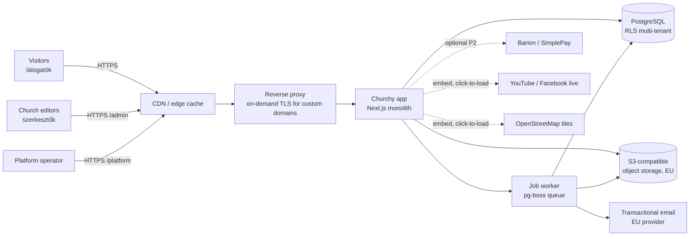
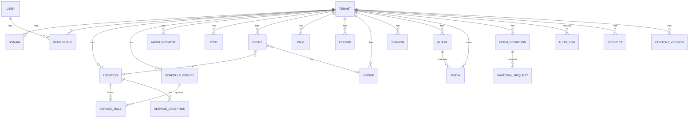
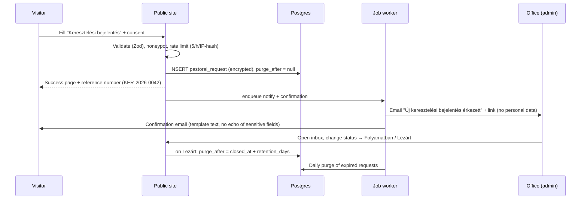
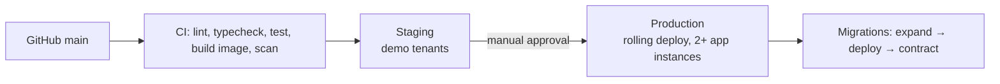

# Churchy — Solution Design Document (SDD)

| | |
|---|---|
| **Product** | Churchy — customizable website platform for Hungarian churches |
| **Document** | Solution Design Document |
| **Version** | 1.0 (draft) |
| **Date** | 2026-11-12 |
| **Inputs** | [01-PRD.md](./01-PRD.md) |
| **Outputs** | [03-DELIVERABLES.md](./03-DELIVERABLES.md) |

Requirement IDs (`FR-…`, `NFR-…`, `L-…`, `C-…`) refer to the PRD.

---

## 1. Design principles

1. **Configuration, not code.** Every difference between churches is data: preset + overrides + theme tokens + module flags. No per-church branches or templates (G4).
2. **The schedule is the product.** The service-schedule engine is the most carefully designed, most tested component (FR-002, G2).
3. **Boring, proven technology.** One TypeScript monolith, one PostgreSQL database, one object store. Easy to run, cheap to host, easy to hire for.
4. **Server-rendered and cached.** Public pages are static-fast HTML regenerated on publish; JavaScript is an enhancement (NFR-01, NFR-09).
5. **Privacy by default.** No trackers, EU-only data, minimal personal data, special-category data isolated (NFR-06, C-03).
6. **Structured customization.** Curated themes and section blocks guarantee every site looks good and stays accessible, whatever the editor does (FR-104, NFR-04).

## 2. System context



## 3. Technology stack

| Layer | Choice | Rationale |
|---|---|---|
| Language | **TypeScript** (strict) | One language front-to-back; typed config schemas. |
| Web framework | **Next.js (App Router)**, React Server Components | SSR + incremental static regeneration with tag-based revalidation; one app hosts public sites, admin and platform console. |
| Styling | **Tailwind CSS** + CSS custom properties for theme tokens | Themes swap tokens at runtime without rebuilds. |
| UI components (admin) | Radix UI primitives + own component library | Accessible primitives (focus management, ARIA). |
| Rich text | **Tiptap** (ProseMirror) storing JSON | Structured content, safe rendering, paste cleanup. |
| ORM / migrations | **Drizzle ORM** | SQL-first, typed, supports RLS-friendly raw SQL. |
| Database | **PostgreSQL 16** | RLS for tenant isolation, ICU collation `hu-HU`, built-in `hungarian` full-text config, `unaccent`. |
| Background jobs | **pg-boss** (Postgres-backed queue) | No extra infrastructure; email, image processing, retention purges, reminders. |
| Object storage | S3-compatible in an EU region | Media and PDFs; signed URLs for private files. |
| Image processing | **sharp** | Resize to AVIF/WebP + JPEG fallback, strip EXIF/GPS. |
| Auth | **Auth.js** (email magic link + password) + TOTP (otplib) | Simple for elderly users (magic link); 2FA for admins (FR-309). |
| Validation | **Zod** | Shared schemas for forms, API, config. |
| Email | Transactional provider with EU data residency, via SMTP/API adapter | Swappable. Templates in **React Email**, Hungarian. |
| Reverse proxy / TLS | **Caddy** with on-demand TLS (ask-endpoint validates domain against DB) | Automatic Let's Encrypt certificates for custom domains (FR-108). |
| CDN | EU-capable CDN in front of Caddy, caching public HTML and assets | Sunday-morning peaks (NFR-03). |
| Hosting | Containers (Docker) on EU infrastructure; managed Postgres with PITR | GDPR residency (NFR-06), backups (NFR-07). |
| Observability | Sentry-compatible error tracking (self-hosted or EU), OpenTelemetry traces, uptime monitor | NFR-12. |
| Testing | Vitest (unit), Playwright (E2E + visual), axe-core (a11y), k6 (load) | See §17. |
| CI/CD | GitHub Actions → container registry → staged rollout | |

## 4. Multi-tenancy

### 4.1 Tenant resolution

Every request is resolved to exactly one tenant (church) by host name:

```
request.host
  ├─ "<slug>.churchy.hu"           → tenant by slug
  ├─ custom domain (domains table) → tenant by domain (www. normalized, redirect to primary)
  ├─ "admin.churchy.hu"/... none    → platform routes only
  └─ unknown                        → 404 "Ez az oldal nem található"
```

Implemented in Next.js middleware: host → `tenantId` lookup (cached in-memory LRU, 60 s TTL, invalidated on domain change). The tenant id is placed in a request header consumed by server components and route handlers.

### 4.2 Data isolation

- Shared database, shared schema; **every tenant-owned table has `tenant_id uuid not null`**.
- **PostgreSQL Row-Level Security** on all tenant tables: `USING (tenant_id = current_setting('app.tenant_id')::uuid)`.
- The app connects as a non-owner role without `BYPASSRLS`; each request opens a transaction and runs `SET LOCAL app.tenant_id = …`. Platform-console queries use a separate role and are audit-logged.
- Object storage keys are prefixed `t/<tenant_id>/…`; private files (request attachments, PDFs of requests) are only served via short-lived signed URLs after a permission check.
- Automated test (D-03 in deliverables): for every tenant table, attempt cross-tenant read/write and assert failure.

### 4.3 Caching per tenant

- Public pages are rendered with ISR and tagged `t:<tenantId>`, `t:<tenantId>:<module>`, `t:<tenantId>:<entity>:<id>`.
- On publish/update, the app calls `revalidateTag` for the affected tags and purges the CDN by surrogate key.
- The schedule pages and "next services" widget are additionally revalidated **hourly and at midnight Europe/Budapest** so "Ma / Holnap" labels stay correct without edits.

## 5. Customization model

All per-church differences live in one validated **SiteConfig** document plus content tables.

### 5.1 Configuration layering

```
effectiveConfig = deepMerge(
  platformDefaults,
  denominationPreset[tenant.denomination],   // terminology, modules, rites, serviceTypes, homeLayout
  tenant.siteConfig                          // church overrides (only stored diffs)
)
```

Only overrides are stored, so improvements to presets reach every church automatically.

### 5.2 SiteConfig schema (abridged, Zod-defined)

```ts
type SiteConfig = {
  identity: {
    name: string;                 // "Budapest-Belvárosi Nagyboldogasszony Főplébánia"
    shortName: string;            // "Belvárosi Plébánia"
    tagline?: string;
    logoMediaId?: string;
    faviconMediaId?: string;
  };
  denomination: 'rk' | 'gk' | 'ref' | 'ev' | 'bapt' | 'unit' | 'general';
  terminology: Partial<Record<TermKey, TermForms>>;   // overrides
  theme: {
    themeId: 'klasszikus' | 'letisztult' | 'kozossegi';
    colors: { primary: string; secondary: string; accent?: string };
    fontPairing: 'serif-classic' | 'humanist' | 'modern-sans';
    heroStyle: 'image-full' | 'image-split' | 'text-only';
    radius: 'none' | 'small' | 'large';
  };
  modules: Record<ModuleKey, boolean>;
  navigation: NavItem[];          // max depth 2
  home: HomeSection[];            // ordered
  footer: { showMap: boolean; links: NavItem[]; dioceseLink?: { label: string; url: string } };
  contact: { email?: string; phone?: string; officeHours: OfficeHours; };
  legal: ImpresszumData & PrivacyData;
  giving: { accountName?: string; accountNumber?: string; iban?: string;
            reference?: string; szja1TechnicalNumber?: string; foundationTaxNumber?: string;
            showQr: boolean };
  integrations: { youtubeChannelUrl?: string; facebookUrl?: string; instagramUrl?: string;
                  livestream?: { provider: 'youtube' | 'facebook' | 'other'; url: string } };
};
```

### 5.3 Terminology

Terms are stored with the grammatical forms the UI needs, so the UI never has to suffix a word at runtime:

```ts
type TermForms = {
  nom: string;        // "Miserend"        — headings, nav
  lower: string;      // "miserend"        — inside sentences
  slug: string;       // "miserend"        — URL segment
  plural?: string;    // "szentmisék"
  article: 'a' | 'az';// "a miserend", "az istentiszteleti rend"
};
```

Usage: `t.term('serviceSchedule').nom`. Message catalogs reference terms by placeholder, e.g. `"home.nextServices": "Következő {service.plural}"`. When a church overrides a term with a new slug, the old slug is stored in `redirects` and returns HTTP 301 (FR-102).

### 5.4 Themes

A theme = a set of design tokens + layout variants for a fixed set of components (header, hero, cards, footer). Themes never contain content.

| Token group | Examples |
|---|---|
| Color | `--c-primary`, `--c-primary-contrast`, `--c-surface`, `--c-text`, `--c-muted`, `--c-accent` |
| Typography | `--font-heading`, `--font-body`, scale steps `--fs-1…--fs-7` (base 17 px) |
| Shape | `--radius-sm/md/lg`, `--shadow-card` |
| Spacing | 4 px grid, `--space-1…--space-12` |

| Theme | Character | Fonts (self-hosted, latin-ext) |
|---|---|---|
| **Klasszikus** | Traditional, serif headings, cream background, gold/burgundy accents; suits historic churches. | Cormorant Garamond + Source Sans 3 |
| **Letisztult** | Minimal, lots of white space, single strong brand color; suits modern/urban congregations. | Inter + Inter |
| **Közösségi** | Warm, rounded cards, photo-forward; suits families/free churches. | Nunito + Nunito Sans |

All fonts are self-hosted with `latin-ext` subsets (ő, ű). Color pickers compute contrast in real time; a color whose contrast against its paired foreground is < 4.5:1 cannot be saved and the editor is shown the nearest passing shade (FR-103).

### 5.5 Modules

```ts
type ModuleKey = 'news' | 'announcements' | 'events' | 'schedule' | 'locations'
  | 'staff' | 'rites' | 'groups' | 'sermons' | 'livestream' | 'gallery' | 'documents'
  | 'giving' | 'onlineGiving' | 'massIntentions' | 'funeralNotices' | 'newsletter'
  | 'search' | 'liturgicalCalendar';
```

A module registry declares, per module: routes, admin menu entries, home sections it offers, nav item defaults, permissions it introduces, and sitemap contributions. Disabling a module hides all of these and returns 404 for its routes (content is preserved).

## 6. Information architecture (public site)

Default URL map (slugs shown for the Roman Catholic preset; term-driven slugs in *italics* change by preset):

| Route | Page | Module |
|---|---|---|
| `/` | Kezdőlap | core |
| `/`*`miserend`* | Service schedule (this week; `?datum=2026-12-24`; `?hely=<location>`) | schedule |
| `/hirdetesek` | Latest weekly announcements | announcements |
| `/hirdetesek/2026-11-15` | Announcements for the week of that Sunday | announcements |
| `/hirek`, `/hirek/<slug>` | News list / detail | news |
| `/esemenyek`, `/esemenyek/<slug>`, `/esemenyek/naptar` | Events list / detail / month view | events |
| `/esemenyek.ics` | iCal feed | events |
| `/templomaink/<slug>` | Location detail (title term-driven) | locations |
| `/munkatarsaink` | Clergy & staff | staff |
| `/kozossegeink`, `/kozossegeink/<slug>` | Groups | groups |
| `/`*`szentsegek`*`/<rite>` | Rite info page (e.g. `/szentsegek/keresztelo`; Reformed: `/alkalmak/keresztelo`) | rites |
| `/`*`szentsegek`*`/<rite>/bejelentes` | Request form | rites |
| `/`*`homiliak`*, `/…/<slug>`, `/…/podcast.xml` | Sermons | sermons |
| `/elo` | Livestream | livestream |
| `/galeria`, `/galeria/<album>` | Gallery | gallery |
| `/dokumentumok` | Documents | documents |
| `/tamogatas` | Support / giving | giving |
| `/kapcsolat` | Contact | core |
| `/kereses?q=` | Search | search |
| `/impresszum`, `/adatkezeles`, `/akadalymentesseg` | Legal pages | core |
| `/<page-slug>` | Static pages (Rólunk, Történetünk…) | core |
| `/sitemap.xml`, `/robots.txt` | SEO | core |

Default main navigation (≤ 7 items, preset-driven): **Kezdőlap · Miserend · Hirdetések · Események · Szentségek · Rólunk ▾ · Kapcsolat**, plus a prominent **Támogatás** button.

## 7. Page designs

### 7.1 Home page (Kezdőlap) — mobile first

```
┌──────────────────────────────────┐
│ [logo] Belvárosi Plébánia     ☰  │  sticky header, 56px
├──────────────────────────────────┤
│  ┌──────────────────────────────┐│
│  │  hero photo of the church    ││  hero (theme variant)
│  │  "Isten hozott!"             ││  tagline
│  └──────────────────────────────┘│
│ ● ÉLŐ  Most közvetítünk  ▶       │  only while a livestream is live
├──────────────────────────────────┤
│ KÖVETKEZŐ SZENTMISÉK             │  next-services card (always first
│ Ma, csütörtök                    │  below hero; cannot be removed when
│  18:00  Nagyboldogasszony-templom│  the schedule module is on)
│ Holnap, péntek                   │
│   7:00  Szent Anna-kápolna       │
│  18:00  Nagyboldogasszony-templom│
│  ⚠ Nov. 15-én a 10 órai mise    │  upcoming exception highlighted
│    8:30-kor kezdődik.            │
│ [Teljes miserend →]              │
├──────────────────────────────────┤
│ HETI HIRDETÉSEK  nov. 9–15.      │
│ • Szombaton 15 órakor …          │
│ [Elolvasom] [PDF ↓]              │
├──────────────────────────────────┤
│ HÍREK            [Összes →]      │
│ [img] Adventi koszorúkötés …     │  3 cards
├──────────────────────────────────┤
│ ESEMÉNYEK        [Naptár →]      │
│ NOV 20  Ifjúsági est  19:00      │  date-badge list (3–5)
├──────────────────────────────────┤
│ 📍 1056 Budapest, Március 15. tér │  map (click-to-load) + address
│ [Útvonaltervezés]                │  deep link to maps app
├──────────────────────────────────┤
│ footer: contact · office hours · │
│ Impresszum · Adatkezelés · social│
└──────────────────────────────────┘
```

Desktop (≥ 1024 px): two-column under the hero — left: next services + announcements; right: news + events. Max content width 1200 px.

### 7.2 Service schedule page (Miserend)

- Top: location filter chips (*Mind · Nagyboldogasszony-templom · Szent Anna-kápolna*) and a week switcher (`‹ Előző hét · Ez a hét · Következő hét ›`) plus a date picker.
- Body: one row per day `Hétfő, nov. 10.` → list of services `time · location · type badge · language badge · note`. Today highlighted; past services dimmed.
- Exceptions shown inline with a reason badge (*Elmarad*, *Változás*, *Rendkívüli*).
- Below: "Általános miserend" — the regular weekly table per location and season, with validity (*Érvényes: 2026. szeptember 1-jétől*).
- Print stylesheet: one-page weekly schedule suitable to post on the church door.

### 7.3 Announcements (Hirdetések)

- Heading `Hirdetések — 2026. november 15. (Évközi 33. vasárnap)` (liturgical day name from the calendar engine, preset-dependent).
- Rich text body; attached PDF shown with an inline viewer link and download button.
- Navigation: `‹ Előző hét | Archívum | Következő hét ›`.

### 7.4 Rite pages and request form

- Info page sections: *Mikor és hogyan?*, *Szükséges dokumentumok* (checklist), *Felkészítés*, *Díjak / adomány* (optional), *Kapcsolat* + **[Bejelentés indítása]** button.
- Form: progressive, single-column, large inputs; fields defined by `FormDefinition` (§8); a summary step before submit; privacy notice link and required consent checkbox; success page with what happens next (*„Irodánk 3 munkanapon belül felveszi Önnel a kapcsolatot.”*).
- Uses formal address (*Ön*) throughout.

### 7.5 Other pages (summary)

| Page | Key design points |
|---|---|
| News detail | Title, date (`2026. november 12.`), cover image with alt text, body, share buttons (Facebook, Messenger, copy link — no tracking scripts, plain share URLs), "Kapcsolódó hírek". |
| Event detail | Date/time block, location card with map link, recurrence description in Hungarian (*„Minden hónap első péntekén 18:00-kor”*), add-to-calendar (.ics, Google). |
| Staff | Grid of cards, grouped; email shown as obfuscated mailto, phone as `tel:` link. |
| Support | Account number with copy button, payment reference, QR code (instant payment), 1% section with technical/tax number and short explanation. |
| Contact | Office hours table with today highlighted and *„Most nyitva / Most zárva”* status; exceptions (*„Az iroda júl. 15–31. között zárva tart.”*); contact form. |

## 8. Domain & data model

### 8.1 Entity overview



### 8.2 Key tables (abridged)

| Table | Key columns |
|---|---|
| `tenants` | `id, slug, name, denomination, status(active/suspended), site_config jsonb, plan, created_at` |
| `domains` | `id, tenant_id, hostname unique, is_primary, verified_at, tls_status` |
| `users` | `id, email unique, name, password_hash?, totp_secret_enc?, last_login_at` |
| `memberships` | `user_id, tenant_id, role(owner/admin/editor/office/group_leader), group_ids uuid[]` |
| `locations` | `id, tenant_id, name, slug, kind(templom/kapolna/filia/egyeb), address jsonb, geo point, opening_hours jsonb, accessibility jsonb, photo_media_id, sort` |
| `schedule_periods` | `id, tenant_id, name ("Általános", "Nyári miserend"), valid_from date?, valid_to date?, recurrence(yearly bool), priority int` |
| `service_rules` | `id, tenant_id, period_id, location_id, weekday 1–7, nth_week? (e.g. 1 = first of month), time, duration_min, service_type, language, title?, note?, livestream bool` |
| `service_exceptions` | `id, tenant_id, location_id?, date, kind(cancel/add/modify), rule_id?, time?, service_type?, note, reason` |
| `announcements` | `id, tenant_id, week_sunday date unique per tenant, body jsonb, pdf_media_id?, status, published_at` |
| `posts` | `id, tenant_id, slug, title, lead, body jsonb, cover_media_id, categories text[], status, publish_at, expires_at?, search tsvector` |
| `events` | `id, tenant_id, slug, title, body, starts_at, ends_at, all_day, rrule?, exdates date[], location_id?, group_id?, category, cover_media_id, status` |
| `pages` | `id, tenant_id, slug, title, blocks jsonb, parent_id?, status, seo jsonb` |
| `people` | `id, tenant_id, prefix?, family_name, given_name, suffix?, role_title, group(clergy/staff/council/volunteer), bio, email?, phone?, photo_media_id, sort` |
| `groups` | `id, tenant_id, slug, name, description, meeting_info, leader_person_id?, contact_email?` |
| `sermons` | `id, tenant_id, slug, title, preacher_person_id?, date, bible_ref, series?, audio_media_id?, external_url?, duration_s` |
| `media` | `id, tenant_id, kind(image/pdf/audio/other), storage_key, variants jsonb, width, height, bytes, alt, caption, people_consent bool, uploaded_by` |
| `form_definitions` | `id, tenant_id, key ("keresztelo"), title, fields jsonb, notify_emails text[], confirmation_text, retention_days` |
| `pastoral_requests` | `id, tenant_id, form_id, data_enc bytea, status(uj/folyamatban/lezart), assignee_id?, notes_enc?, consent_at, consent_text_hash, closed_at?, purge_after` |
| `content_versions` | `id, tenant_id, entity, entity_id, snapshot jsonb, author_id, created_at` |
| `audit_log` | `id, tenant_id?, actor_id, action, entity, entity_id, diff jsonb, ip_hash, at` |
| `redirects` | `tenant_id, from_path, to_path, code` |
| `newsletter_subscribers` (P2) | `id, tenant_id, email, confirmed_at, unsubscribe_token` |

All text columns used for sorting use collation `"hu-HU-x-icu"` (L-03). Search columns use `to_tsvector('hungarian', unaccent(...))` (L-09).

### 8.3 Pastoral request encryption

`pastoral_requests.data_enc` and `notes_enc` are encrypted at the application layer (AES-256-GCM, envelope encryption: per-tenant data key encrypted by a platform master key held in the secrets manager). Consequences:
- DB dumps/backups never contain plaintext religious data (C-03).
- Search over requests is limited to status/date/form type (by design).
- Purge job deletes rows where `purge_after < now()` daily and records the count (not content) in the audit log.

## 9. Service schedule engine

The engine turns rules + periods + exceptions into concrete services for any date range. It is a pure, framework-independent TypeScript module (`packages/schedule`) with exhaustive unit tests.

### 9.1 Algorithm

```
resolve(tenant, from, to, locationFilter?) -> Service[]:
  for each date d in [from, to] (Europe/Budapest):
    periods = activePeriods(d)                 # valid_from ≤ d ≤ valid_to (yearly periods match month-day)
    # per location: the active period with highest priority wins (e.g. "Nyári" > "Általános")
    for each location L:
      p = max(periods where p has rules for L, by priority)
      base = p.rules where rule.location = L
                         and rule.weekday = isoWeekday(d)
                         and (rule.nth_week is null or matchesNth(d, rule.nth_week))
      services += base.map(toService(d))
    apply exceptions for d in order: cancel → modify → add
    mark feast context: liturgicalDay(d, tenant.denomination), publicHoliday(d)
  return sorted by (date, time, location.sort)
```

### 9.2 Feast-aware defaults

- `packages/calendar` computes Western Easter (Gregorian computus) and derived moveable days: Hamvazószerda, Virágvasárnap, Nagycsütörtök, Nagypéntek, Nagyszombat, Húsvétvasárnap/-hétfő, Áldozócsütörtök (Ascension), Pünkösdvasárnap/-hétfő, Úrnapja (Catholic), Advent Sundays; and fixed Hungarian holidays (jan. 1., márc. 15., máj. 1., aug. 20., okt. 23., nov. 1., dec. 24–26.).
- Catholic preset adds the general Roman calendar's solemnities and Sunday naming (*Évközi 33. vasárnap*); Protestant presets use Sunday naming of the Protestant church year (e.g. *Szentháromság ünnepe utáni 23. vasárnap*), configurable per preset.
- **Holiday templates** (FR-312): e.g. "Nagyhét" generates editable exceptions for Nagycsütörtök–Húsvéthétfő for each location; "Karácsony" for Dec 24–26; "Szilveszter/Újév". Editors review a preview before applying.
- Warning rules for the dashboard: a public holiday or feast in the next 14 days with **no exceptions defined** → *„Jövő héten Mindenszentek ünnepe van. Ellenőrizte a miserendet?”*.

### 9.3 Display rules

- "Next services" widget: services from *now* to end of tomorrow; if none, the next 3 services within 14 days; labels *Ma*, *Holnap*, otherwise `Szombat, nov. 15.`.
- Services within the past 60 minutes show *„Most zajlik”* if a livestream is linked.
- All times computed in `Europe/Budapest` regardless of server TZ; DST transitions covered by tests.

## 10. Events & recurrence

- Recurrence uses RFC 5545 RRULE (via `rrule` library) with Hungarian human-readable rendering implemented in-house (`„Minden héten kedden és csütörtökön”`, `„Minden hónap utolsó vasárnapján”`).
- Expansion happens at read time for a bounded window (max 400 days); `exdates` cancel occurrences; single-occurrence overrides stored as child events with `recurrence_id`.
- iCal feed (`/esemenyek.ics`) and per-event `.ics` generated with `VTIMEZONE` Europe/Budapest.

## 11. Admin application

### 11.1 Structure

Served at `/admin` on each church's own domain (so cookies are first-party and scoped per domain), plus a platform console at `platform.churchy.hu`.

```
Vezérlőpult (dashboard)
├─ Gyors feladatok: [Heti hirdetés] [Miserend-változás] [Új hír] [Új esemény]
├─ Figyelmeztetések (warnings)
└─ Új kérések (3)
Tartalom
├─ Hirdetések · Hírek · Események · Oldalak · Igehirdetések · Galéria · Dokumentumok
Miserend / Istentiszteleti rend
├─ Heti rend (periods & rules)  ├─ Kivételek  ├─ Ünnepi sablonok
Helyszínek · Munkatársak · Közösségek
Kérések (inbox)
Megjelenés
├─ Arculat (logo, colors, fonts) ├─ Téma ├─ Kezdőlap ├─ Menü ├─ Lábléc
Beállítások
├─ Általános ├─ Felekezet & szóhasználat ├─ Modulok ├─ Kapcsolat & nyitvatartás
├─ Támogatás ├─ Jogi adatok (Impresszum, Adatkezelés) ├─ Domain ├─ Felhasználók ├─ Napló
```

### 11.2 UX rules for non-technical editors (FR-301)

- Base font 17 px, touch targets ≥ 44 × 44 px, high-contrast admin theme.
- One primary action per screen; destructive actions require confirmation with the item name.
- Plain Hungarian labels (*„Közzététel”*, *„Mentés piszkozatként”*, *„Időzítés”*), contextual help text under each field, no technical terms (no "slug": *„Webcím”* with auto-generation).
- Autosave every 10 s with *„Mentve 12:04-kor”* indicator; leaving with unsaved changes warns.
- "Preview as visitor" opens the real page in draft mode (signed preview cookie).
- Weekly announcement flow: **3 steps** — (1) choose the week (defaults to the coming Sunday), (2) paste text or upload PDF, (3) Közzététel. PDF text is extracted to make it searchable.
- Schedule exception flow: pick date(s) → pick affected services from a list (generated by the engine) → *Elmarad / Időpont változik / Új alkalom* → note → preview of the week → save.

### 11.3 Roles & permissions matrix

| Capability | Tulajdonos | Adminisztrátor | Szerkesztő | Iroda | Csoportvezető |
|---|:-:|:-:|:-:|:-:|:-:|
| Manage users & roles | ✔ | ✔ (not owners) | | | |
| Domain, legal data, delete site | ✔ | | | | |
| Appearance, modules, navigation, terminology | ✔ | ✔ | | | |
| Pages, news, gallery, sermons, documents | ✔ | ✔ | ✔ | | |
| Announcements | ✔ | ✔ | ✔ | ✔ | |
| Schedule (rules & exceptions), locations, office hours | ✔ | ✔ | | ✔ | |
| Events | ✔ | ✔ | ✔ | ✔ | own group only |
| Group page | ✔ | ✔ | ✔ | | own group only |
| Pastoral requests (read/handle) | ✔ | ✔ | | ✔ | |
| Audit log | ✔ | ✔ | | | |

Permissions are checked server-side in a single `can(user, action, resource)` policy module; UI hides what a role can't do. Every policy has a unit test.

## 12. Request handling flow



## 13. Security design

| Area | Design |
|---|---|
| Authentication | Magic-link email (15-min single-use token) or password (Argon2id, breached-password check offline list); TOTP 2FA, mandatory for owner/admin; session cookie `HttpOnly; Secure; SameSite=Lax`, 30-day sliding expiry, revocable server-side sessions. |
| Authorization | Central policy module, server-side checks on every mutation; tenant enforced again by RLS (defense in depth). |
| Input/output | Zod validation; rich text stored as ProseMirror JSON and rendered via an allow-list renderer (no raw HTML); embeds restricted to an allow-list of providers (YouTube, Facebook, Vimeo, SoundCloud, OpenStreetMap). |
| Headers | Strict CSP with nonces, HSTS (preload for platform domain), `X-Content-Type-Options`, `Referrer-Policy: strict-origin-when-cross-origin`, `Permissions-Policy` minimal. |
| CSRF | Server Actions with origin checks; SameSite cookies. |
| Rate limiting | Login, magic link, forms, search (Postgres-backed token bucket keyed by hashed IP + tenant). |
| Uploads | MIME sniffing, size limits (images 20 MB, PDF 30 MB, audio 200 MB), images re-encoded (strips EXIF/GPS), PDFs served with `Content-Disposition` and from a separate cookieless media host. |
| Secrets | Secrets manager / environment injection, never in repo; master encryption key rotation procedure documented. |
| Custom domains | Caddy on-demand TLS asks `/api/tls-allow?domain=` which only approves verified domains (DNS TXT or CNAME check) — prevents certificate abuse. |
| Supply chain | Lockfile, Renovate, `npm audit`/OSV scan, container image scan, signed images. |
| Admin impersonation | Platform operators can only impersonate after the church owner grants time-limited support access; fully audit-logged. |

## 14. Privacy & compliance implementation

- **Impresszum generator** (C-01): structured fields in *Beállítások → Jogi adatok*; page rendered from a template including platform-operator/hosting data automatically.
- **Privacy notice generator** (C-02): template with sections (controller, purposes, legal bases, retention, processors, rights, NAIH complaint route); church fills controller data; processors list is injected by the platform. Version-hashed; consent records store the hash.
- **No-cookie default** (C-04): session cookies only on `/admin`. Public pages set no cookies. Embeds use a click-to-load facade (*„A videó megtekintéséhez kattintson. A YouTube sütiket helyezhet el.”*); consent remembered in `localStorage` per provider.
- **Analytics** (optional): self-hosted, cookieless (e.g. Plausible-style) aggregated page views; shown in the dashboard.
- **Data subject requests**: admin can search requests by reference number and delete; export of a single request.
- **Photo consent** (C-06): upload dialog asks *„Felismerhető személyek szerepelnek a képen? Rendelkezik a hozzájárulásukkal?”*; flag stored per image.

## 15. Performance, SEO & caching

- Public routes are statically rendered per tenant and cached at the CDN (`s-maxage=300, stale-while-revalidate=86400`); tag purge on publish makes updates visible in ≤ 60 s.
- Images: responsive `srcset`, AVIF/WebP, lazy-loading below the fold, explicit dimensions (no CLS); hero image preloaded.
- JS budget: ≤ 70 KB gzipped on public pages (mostly menu, lightbox, date picker as islands).
- Fonts: self-hosted, `font-display: swap`, subset `latin` + `latin-ext`.
- Structured data: `Church` (or `PlaceOfWorship`) with `address`, `geo`, `openingHoursSpecification`, `event` list; `Event` on event pages; `NewsArticle` on posts; `BreadcrumbList`.
- `sitemap.xml` per tenant; `hreflang="hu"`; `<html lang="hu">`.

## 16. Accessibility

- WCAG 2.1 AA as a hard requirement: semantic landmarks, skip link (*„Ugrás a tartalomra”*), visible focus, ARIA only where needed, all images require alt text or explicit "decorative", captions/transcripts field for sermons.
- Contrast enforcement in theme editor; theme tokens tested with automated contrast checks for every theme × curated palette.
- Respects `prefers-reduced-motion` and `prefers-color-scheme` (themes ship light variant; dark variant P2).
- Font-size control (A/A+/A++) on public sites for older visitors.
- Automated axe-core checks in CI on every route of the demo tenants; manual screen-reader pass (NVDA + VoiceOver) before GA.

## 17. Testing strategy

| Level | Scope | Tooling | Gate |
|---|---|---|---|
| Unit | Schedule engine, calendar/Easter, RRULE Hungarian rendering, terminology, permissions, formatting (dates, names, addresses, accounts), encryption | Vitest | ≥ 90 % coverage of `packages/schedule`, `packages/calendar`; ≥ 80 % domain overall |
| Integration | DB with RLS, server actions, job handlers | Vitest + Testcontainers Postgres | Cross-tenant isolation suite must pass |
| E2E | Critical journeys (visitor + editor) on each denomination demo tenant | Playwright | 100 % pass on main |
| Visual regression | Each theme × key pages × mobile/desktop | Playwright screenshots | Reviewed diffs |
| Accessibility | All public routes + admin core screens | axe-core, Lighthouse CI | 0 serious/critical violations; Lighthouse a11y ≥ 95 |
| Performance | Home, schedule, news detail | Lighthouse CI, WebPageTest profile "Moto G / 4G" | Perf ≥ 90, LCP ≤ 2.5 s |
| Load | Sunday peak simulation | k6 | 200 req/s, p95 < 500 ms uncached, error rate < 0.1 % |
| Usability | Editors aged 55+, visitors | Moderated sessions (5 + 5) | NFR-10, G2 targets |

Seed data: 3 demo tenants (Catholic multi-location parish, Reformed congregation, Baptist church) with realistic Hungarian content, used by E2E, visual and performance tests and for sales demos.

## 18. Deployment & operations



- **Environments:** local (Docker Compose: app, Postgres, MinIO, Mailpit, Caddy), staging, production.
- **Runtime:** ≥ 2 app containers behind Caddy, 1 worker container; managed PostgreSQL with PITR and daily logical backups to separate EU storage (NFR-07); object storage with versioning.
- **Migrations:** backwards-compatible expand/contract; zero-downtime.
- **Monitoring:** uptime check per primary domain (sample-based for large fleets), error tracking, Postgres metrics, queue depth, TLS expiry alerts, purge-job heartbeat.
- **Runbooks:** restore from backup, rotate master key, custom domain troubleshooting, tenant export/delete, incident response (GDPR 72-hour notification).

## 19. Church onboarding flow

1. Operator (or self sign-up, later) runs **Új egyház** wizard: name, denomination, town/address, owner email, subdomain → tenant created with preset config and sample content flagged *„Mintatartalom”*.
2. Owner receives invitation (magic link) → lands on **onboarding checklist**:
   1. Logó és színek (2 min)
   2. Helyszínek és címek (3 min)
   3. Miserend / istentiszteleti rend (15–30 min, guided by weekly grid)
   4. Kapcsolat és irodai nyitvatartás (5 min)
   5. Munkatársak (10 min)
   6. Jogi adatok — Impresszum & Adatkezelés (10 min)
   7. Első hirdetés / hír (5 min)
   8. Mintatartalom törlése (1 click)
   9. Domain beállítása (optional; DNS instructions in Hungarian with registrar-specific tips)
3. Checklist progress shown on dashboard; the site shows a discreet *„Hamarosan”* banner until the owner presses **Oldal élesítése**.

## 20. Repository structure

```
churchy/
├─ apps/
│  └─ web/                    # Next.js: public sites, /admin, platform console
│     ├─ app/(public)/…
│     ├─ app/admin/…
│     ├─ app/platform/…
│     └─ middleware.ts        # tenant resolution
├─ packages/
│  ├─ schedule/               # pure schedule engine
│  ├─ calendar/               # Easter, feasts, Hungarian holidays, liturgical day names
│  ├─ hu/                     # formatting: dates, names, addresses, accounts, slugs, a/az
│  ├─ presets/                # denomination presets (terminology, modules, rites, forms)
│  ├─ themes/                 # tokens + component variants
│  ├─ db/                     # Drizzle schema, migrations, RLS policies
│  ├─ policy/                 # permissions
│  ├─ jobs/                   # worker handlers
│  └─ ui/                     # shared accessible components
├─ messages/hu.json           # all UI strings
├─ infra/                     # Docker, Caddy, compose, IaC
├─ e2e/                       # Playwright
└─ docs/                      # PRD, SDD, deliverables, ADRs, runbooks
```

## 21. Key decisions (ADR summary)

| # | Decision | Alternatives considered | Why |
|---|---|---|---|
| ADR-1 | Hosted multi-tenant SaaS, shared schema + RLS | Per-church WordPress; DB-per-tenant | Lowest ops cost at 1,000 tenants; one upgrade path; RLS gives strong isolation. |
| ADR-2 | Next.js monolith with ISR | Headless CMS + separate frontend; WordPress multisite | One deployable, fast pages, full control of Hungarian UX and schedule engine. |
| ADR-3 | Structured customization (themes + sections), no free page builder | Drag-and-drop builder | Guarantees accessibility, performance, consistent quality for non-designers. |
| ADR-4 | Terminology as data with stored grammatical forms | Runtime Hungarian morphology | Hungarian suffixation is complex; storing forms is simple and correct. |
| ADR-5 | Application-level encryption of pastoral requests | DB-level only | Special-category data must not appear in backups/dumps in plaintext. |
| ADR-6 | Link out to daily readings | Republish texts | Copyright; v1 risk reduction. |
| ADR-7 | Postgres-backed queue (pg-boss) | Redis/BullMQ | One fewer moving part. |
