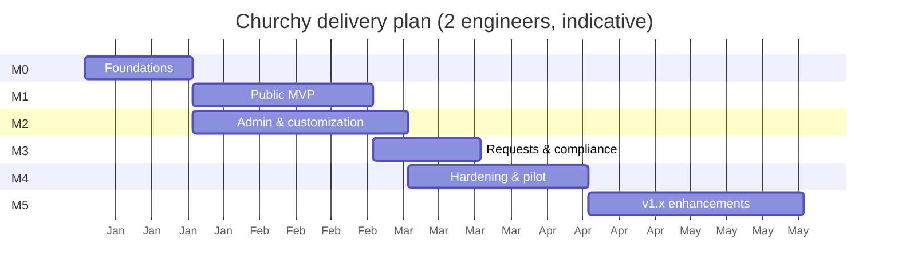

# Churchy — Measurable Deliverables

| | |
|---|---|
| **Document** | Deliverables breakdown & acceptance criteria |
| **Version** | 1.0 (draft) |
| **Date** | 2026-11-12 |
| **Inputs** | [01-PRD.md](./01-PRD.md), [02-SDD.md](./02-SDD.md) |

This document splits the PRD requirements into **deliverables** — units of work that can be demonstrated and verified against objective, measurable acceptance criteria. Each deliverable traces back to PRD requirement IDs and SDD sections.

---

## 1. How to read this document

- **ID** — `D-xx`, stable reference for planning tools and PRs.
- **Traces** — PRD requirement IDs covered (`FR`, `NFR`, `L`, `C`) and SDD section.
- **Acceptance criteria (AC)** — every criterion is binary (pass/fail) and checked by the stated **verification** method. A deliverable is done only when **all** its AC pass and the global Definition of Done (§2) is met.
- **Estimate** — ideal person-days (pd) for one full-stack engineer; for planning only.
- **Priority** — inherited from the PRD (P0 = MVP, P1 = GA, P2 = post-GA).

## 2. Global Definition of Done

Applies to every deliverable in addition to its own AC:

1. Code merged to `main` via reviewed PR; CI green (lint, typecheck, unit, integration, E2E).
2. All user-visible strings in `messages/hu.json`; no hard-coded Hungarian or English UI text in components (checked by lint rule).
3. New public/admin routes pass axe-core with **0 serious/critical** violations.
4. New domain logic has unit tests; overall domain coverage stays **≥ 80 %**.
5. No new high/critical vulnerabilities in dependency or image scans.
6. Feature works on the three demo tenants (Catholic, Reformed, Baptist) where applicable.
7. Docs updated (README/ADR/runbook) when behavior, config or operations change.

## 3. Milestone overview

| Milestone | Goal | Deliverables | Exit criterion | Est. |
|---|---|---|---|---|
| **M0 — Foundations** | Running multi-tenant skeleton, CI/CD, data model | D-01 … D-07 | Two tenants served from one deployment on staging with isolated data | 24 pd |
| **M1 — Public MVP** | A visitor can use a complete church site | D-08 … D-17 | Demo tenants pass the visitor E2E suite on staging | 47 pd |
| **M2 — Admin & customization** | Non-technical editors can run and brand a site | D-18 … D-27 | Editor E2E suite passes; one church configured from zero using only the admin | 50 pd |
| **M3 — Requests & compliance** | Pastoral requests, legal pages, privacy | D-28 … D-33 | Security & privacy review signed off | 25 pd |
| **M4 — Hardening & pilot (GA)** | Quality bars met; real churches live | D-34 … D-41 | 5 pilot churches live ≥ 4 weeks; GA quality gates green | 28 pd |
| **M5 — v1.x enhancements** | P1/P2 scope | D-42 … D-50 | Per deliverable | 45 pd |

**Total to GA (M0–M4): ≈ 174 pd** (≈ 4.5 months for 2 engineers incl. ~10 % buffer, plus design & QA support).

---

## 4. M0 — Foundations

### D-01 Repository, tooling & CI pipeline
- **Traces:** NFR-05, NFR-11 · SDD §3, §18, §20 · **Priority:** P0 · **Est.:** 3 pd
- **AC:**
  1. Monorepo with the structure in SDD §20; `pnpm install && pnpm dev` starts the full local stack (app, Postgres, MinIO, Mailpit, Caddy) in **≤ 5 minutes** on a clean machine.
  2. CI runs lint, typecheck, unit, integration, build and dependency/image scans on every PR; median CI duration **≤ 10 minutes**.
  3. Merges to `main` deploy automatically to staging; production deploy requires manual approval.
- **Verification:** fresh-clone dry run by a second engineer; CI logs.

### D-02 Database schema, migrations & seed data
- **Traces:** SDD §8 · **Priority:** P0 · **Est.:** 5 pd
- **AC:**
  1. All P0 tables from SDD §8.2 exist via versioned Drizzle migrations; `migrate up` then `down` then `up` succeeds.
  2. Text sort columns use `hu-HU-x-icu` collation; `hungarian` text-search config + `unaccent` installed.
  3. Seed script creates the **3 demo tenants** with ≥ 10 news, ≥ 15 events, 2 locations (Catholic), full schedules, 4 weeks of announcements, 6 staff, in Hungarian.
- **Verification:** migration CI job; seed run on staging.

### D-03 Tenant isolation (RLS) & tenant resolution
- **Traces:** NFR-05, FR-108 · SDD §4 · **Priority:** P0 · **Est.:** 5 pd
- **AC:**
  1. Every tenant-owned table has RLS enabled and a policy keyed on `app.tenant_id`; a CI check fails if a new tenant table lacks a policy.
  2. Automated isolation suite: for **100 %** of tenant tables, cross-tenant SELECT/INSERT/UPDATE/DELETE attempts return 0 rows / are rejected.
  3. Host → tenant resolution works for subdomain, custom domain, `www.` variant (301 to primary) and unknown host (404); resolution overhead **≤ 5 ms p95** with warm cache.
- **Verification:** integration tests; middleware benchmark.

### D-04 Authentication & sessions
- **Traces:** FR-308, NFR-05 · SDD §13 · **Priority:** P0 · **Est.:** 4 pd
- **AC:**
  1. Login via magic link (expires in 15 min, single use) and via password (Argon2id).
  2. Login, magic-link and reset endpoints rate-limited (≤ 5 attempts / 15 min / account + IP-hash); verified by test.
  3. Sessions are server-side revocable; "log out all devices" works; cookies `HttpOnly; Secure; SameSite=Lax`.
  4. All auth emails and screens in Hungarian.
- **Verification:** integration + E2E tests; manual security check.

### D-05 Permission policy module
- **Traces:** FR-307 · SDD §11.3 · **Priority:** P0 · **Est.:** 3 pd
- **AC:**
  1. `can(user, action, resource)` implements the full matrix in SDD §11.3.
  2. Unit test for **every cell** of the matrix (5 roles × all capabilities), including group-scoped access for *Csoportvezető*.
  3. Every server mutation calls the policy (enforced by a wrapper; lint/test fails on unwrapped actions).
- **Verification:** unit tests; code review checklist.

### D-06 Hungarian formatting library (`packages/hu`)
- **Traces:** L-02 … L-08 · SDD §5.3 · **Priority:** P0 · **Est.:** 2 pd
- **AC:**
  1. Functions for long/short dates (`2026. november 12., csütörtök`, `2026. 11. 12.`), times (`18:00`), weekday names (Monday-first), relative labels (*Ma, Holnap, Tegnap*), names (family-first with prefix), addresses, phone numbers (`+36 30 123 4567`), bank accounts (8-8-8 / 8-8), slugify without diacritics, article *a/az* selection for words and numbers.
  2. **≥ 60 test cases**, including *a/az* for numbers (1, 5, 10, 50, 100, 1000), digraph collation (`cs` after `c`, `zs` after `z`), and DST boundary dates.
- **Verification:** unit tests with ≥ 95 % coverage of the package.

### D-07 Observability & environments baseline
- **Traces:** NFR-07, NFR-12 · SDD §18 · **Priority:** P0 · **Est.:** 2 pd
- **AC:**
  1. Error tracking captures server and client errors on staging with tenant id tag and **no personal data** (verified by log review of 20 sample events).
  2. Structured JSON logs; uptime check on staging demo domains alerting within 5 minutes.
  3. Managed Postgres PITR enabled; a test restore to a new instance completes successfully.
- **Verification:** staging demo; restore drill record.

---

## 5. M1 — Public MVP

### D-08 Theme system & first theme (*Klasszikus*)
- **Traces:** FR-103, FR-104, NFR-04 · SDD §5.4, §16 · **Priority:** P0 · **Est.:** 6 pd
- **AC:**
  1. Design tokens as CSS custom properties; switching `themeId`/colors in config changes appearance **without rebuild** (verified on staging).
  2. Layout components (header, mobile menu, hero variants, cards, footer) render correctly at 360, 768, 1024, 1440 px (visual regression baselines approved).
  3. Self-hosted fonts with `latin-ext`; ő/Ő/ű/Ű render in the chosen font (visual test string).
  4. Skip link, visible focus, landmarks present; axe-core 0 serious/critical on all M1 routes.
- **Verification:** Playwright visual + axe tests.

### D-09 Service schedule engine (`packages/schedule`, `packages/calendar`)
- **Traces:** FR-002, FR-003, L-10 · SDD §9 · **Priority:** P0 · **Est.:** 8 pd
- **AC:**
  1. Resolves rules + periods (with priority and yearly recurrence) + exceptions (cancel/modify/add) per location for any date range ≤ 400 days.
  2. Supports nth-week-of-month rules (e.g. "first Friday"), seasonal periods, multiple locations.
  3. Easter computed correctly for **all years 1900–2100** (checked against a reference table); all moveable feasts and fixed Hungarian holidays listed in SDD §9.2 produced.
  4. All computations in `Europe/Budapest`; tests for last Sunday of March/October DST transitions.
  5. Line/branch coverage **≥ 90 %**; resolving one year for a 3-location tenant takes **≤ 50 ms**.
- **Verification:** unit tests + benchmark in CI.

### D-10 Home page with "next services"
- **Traces:** FR-001, G2 · SDD §7.1, §9.3 · **Priority:** P0 · **Est.:** 5 pd
- **AC:**
  1. Renders configured sections in configured order; disabled modules' sections are absent.
  2. "Next services" shows today/tomorrow (or next 3 within 14 days) with *Ma/Holnap* labels and upcoming exceptions; labels are correct after midnight without any edit (scheduled revalidation test with mocked clock).
  3. On a 360 × 740 viewport the next-service block is **fully visible without scrolling past one screen** below the hero (visual test).
  4. Lighthouse mobile: Performance ≥ 90, Accessibility ≥ 95, SEO ≥ 95 on all 3 demo tenants.
- **Verification:** E2E + Lighthouse CI.

### D-11 Service schedule page & print view
- **Traces:** FR-002, FR-003 · SDD §7.2 · **Priority:** P0 · **Est.:** 4 pd
- **AC:**
  1. Week view with previous/next week, date picker, location filter; URL reflects state (`?datum=`, `?hely=`) and is shareable.
  2. Exceptions show *Elmarad / Változás / Rendkívüli* badges; service type and language badges shown.
  3. Regular schedule table per location & period with validity text.
  4. Print stylesheet fits one week for a 3-location tenant on **one A4 page** (PDF print test).
  5. Fully usable without JavaScript (filters degrade to links).
- **Verification:** E2E, print-to-PDF snapshot, JS-disabled test.

### D-12 Locations & contact page
- **Traces:** FR-003, FR-008, L-05 · SDD §7.5 · **Priority:** P0 · **Est.:** 4 pd
- **AC:**
  1. Location pages with address, map (click-to-load OSM facade), route-planning deep link, opening hours and accessibility info.
  2. Office hours table with today highlighted and *Most nyitva/Most zárva* computed in Europe/Budapest; exceptions (date ranges) override regular hours.
  3. Contact form with honeypot + rate limit sends email to configured address within **≤ 60 s** (Mailpit test).
  4. No third-party request is made before the visitor clicks the map facade (network log test).
- **Verification:** E2E incl. network assertions.

### D-13 News
- **Traces:** FR-004, FR-023 · SDD §7.5 · **Priority:** P0 · **Est.:** 3 pd
- **AC:**
  1. List (paginated, 12/page) and detail pages; scheduled and expired posts are hidden accordingly.
  2. Open Graph + `NewsArticle` structured data validate (schema validator in CI).
  3. Share links for Facebook, Messenger and copy-link work without loading any third-party script.
- **Verification:** E2E + structured-data test.

### D-14 Weekly announcements
- **Traces:** FR-005 · SDD §7.3 · **Priority:** P0 · **Est.:** 3 pd
- **AC:**
  1. Latest announcement reachable from home and main nav in **1 click**.
  2. Week heading includes the liturgical Sunday name for the tenant's preset (tested for Catholic and Reformed on 10 reference dates).
  3. PDF attachment downloadable and its extracted text searchable (after D-43).
  4. Archive navigation by week; print view.
- **Verification:** E2E; unit tests for heading generation.

### D-15 Events (list, calendar, recurrence, iCal)
- **Traces:** FR-006 · SDD §10 · **Priority:** P0 · **Est.:** 5 pd
- **AC:**
  1. Single, all-day and recurring (RRULE) events with exdates and single-occurrence overrides.
  2. Hungarian human-readable recurrence text for **≥ 15 rule patterns** (weekly multi-day, nth weekday of month, last weekday of month, yearly…) matches expected strings.
  3. Month view and list view; `/esemenyek.ics` and per-event `.ics` import successfully into Google Calendar, Apple Calendar and Outlook (manual check recorded).
  4. `Event` structured data valid.
- **Verification:** unit + E2E + manual calendar import.

### D-16 Static pages, staff & rite information pages
- **Traces:** FR-007, FR-009, FR-010, L-04 · SDD §7.4–7.5 · **Priority:** P0 · **Est.:** 5 pd
- **AC:**
  1. Block renderer supports heading, text, image, gallery, quote, embed (allow-listed), CTA, file download.
  2. Staff page groups people (clergy/staff/council), Hungarian name order, obfuscated emails, `tel:` links.
  3. Rite pages generated from the preset (Catholic: 6 rites; Reformed: 4; Baptist: 4) with editable content and a link to the request form (form itself in D-28).
- **Verification:** E2E per demo tenant.

### D-17 Support page, footer, SEO basics
- **Traces:** FR-015, FR-023, FR-109, NFR-08, L-06 · SDD §7.5, §15 · **Priority:** P0 · **Est.:** 4 pd
- **AC:**
  1. Support page shows formatted account number with copy button, payment reference, 1% section; instant-payment QR code scans correctly in **2 Hungarian banking apps** (manual test recorded).
  2. Footer shows contact, office hours summary, legal links, social icons.
  3. Per-tenant `sitemap.xml`, `robots.txt`, canonical URLs, `<html lang="hu">`, `Church` structured data; Google Rich Results test passes for home and an event.
- **Verification:** E2E + manual QR and rich-results checks.

---

## 6. M2 — Admin & customization

### D-18 Admin shell, navigation & dashboard
- **Traces:** FR-301, FR-302 · SDD §11.1–11.2 · **Priority:** P0 · **Est.:** 5 pd
- **AC:**
  1. Admin IA as in SDD §11.1; base font 17 px; touch targets ≥ 44 px (automated check).
  2. Dashboard quick actions open the respective flows in **1 click**.
  3. Warnings implemented: no announcement for the coming Sunday (from Thursday), feast/holiday in next 14 days without exceptions, unfinished onboarding, new requests.
  4. Admin core screens pass axe-core 0 serious/critical.
- **Verification:** E2E + axe.

### D-19 Rich text editor & media library
- **Traces:** FR-303, FR-306, C-06 · SDD §3, §13 · **Priority:** P0 · **Est.:** 6 pd
- **AC:**
  1. Tiptap editor with headings, lists, links, images, allow-listed embeds; paste from Word/Google Docs produces clean output (5 reference documents tested).
  2. Image upload creates AVIF/WebP/JPEG variants at 4 widths, strips EXIF/GPS (verified), prompts for alt text and people-consent flag.
  3. Uploading a 12 MP photo completes processing in **≤ 10 s**; storage quota shown.
  4. Rendering uses allow-list renderer — XSS test corpus (≥ 30 payloads) produces no script execution.
- **Verification:** unit + E2E + security test corpus.

### D-20 Publishing workflow (draft, preview, schedule)
- **Traces:** FR-304 · SDD §4.3, §11.2 · **Priority:** P0 · **Est.:** 4 pd
- **AC:**
  1. Draft / publish / schedule (date-time) for pages, news, events, announcements.
  2. Preview renders the real public template in draft mode, unavailable to anonymous visitors.
  3. After publish, the public page reflects the change in **≤ 60 s** including CDN (staging measurement over 20 publishes, p95).
- **Verification:** E2E + timing measurement.

### D-21 Content CRUD: news, announcements, events, pages, staff, locations
- **Traces:** FR-004 … FR-010 (admin side) · **Priority:** P0 · **Est.:** 8 pd
- **AC:**
  1. Create/edit/delete (with confirmation) for each type; auto-generated *Webcím* (slug) with uniqueness handling.
  2. **Weekly announcement flow completes in 3 steps**, defaulting to the coming Sunday.
  3. Drag-and-drop ordering for staff and locations.
  4. Editor E2E suite covers each type end-to-end (create → publish → visible on site → delete).
- **Verification:** E2E.

### D-22 Schedule editor with preview & exceptions
- **Traces:** FR-311, FR-002 · SDD §9, §11.2 · **Priority:** P0 · **Est.:** 7 pd
- **AC:**
  1. Weekly grid editor per location and period; add seasonal periods with validity dates and priority.
  2. Before saving, a preview of the resulting services for the next **8 weeks** is shown, with changes highlighted.
  3. Exception flow: pick date → choose affected services from engine output → cancel/change/add → note → save; result appears on the public schedule.
  4. Office role can perform all schedule tasks; editor role cannot (policy tests).
- **Verification:** E2E + policy tests.

### D-23 Denomination presets & terminology overrides
- **Traces:** FR-101, FR-102, §5 of PRD · SDD §5.1–5.3 · **Priority:** P0 · **Est.:** 5 pd
- **AC:**
  1. 7 presets defined (rk, gk, ref, ev, bapt, unit, general) with the terminology table from PRD §5.2, rites, service types, default modules and home layout.
  2. Changing a term updates nav, headings, page titles, admin labels and URL slug; the old URL returns **301** to the new one.
  3. Changing denomination shows a diff preview (terms, modules, rites) before applying.
  4. Each preset reviewed and signed off by a clergy advisor of that denomination (sign-off record in `docs/presets-review.md`) — required for GA (M4).
- **Verification:** unit + E2E; review records.

### D-24 Appearance: branding, themes, home composer, navigation, footer
- **Traces:** FR-103 … FR-107, FR-109 · SDD §5.4 · **Priority:** P0 · **Est.:** 7 pd
- **AC:**
  1. Two more themes delivered (*Letisztult*, *Közösségi*) → **3 themes** total, each passing visual, axe and Lighthouse gates.
  2. Color picker blocks saving any color combination below **4.5:1** contrast and suggests the nearest passing shade.
  3. Home composer: add/remove/reorder ≥ 10 section types with per-section settings; live preview.
  4. Navigation editor: rename, reorder, nest (max 2 levels), external links.
- **Verification:** E2E + visual + automated contrast tests.

### D-25 Module toggles & module registry
- **Traces:** FR-105 · SDD §5.5 · **Priority:** P0 · **Est.:** 3 pd
- **AC:**
  1. Toggling a module off removes its nav items, home sections, sitemap entries and admin menu, and its routes return 404; toggling on restores them with content intact.
  2. Test matrix covers all P0/P1 modules on/off.
- **Verification:** E2E matrix.

### D-26 User management & roles
- **Traces:** FR-307, FR-308 · SDD §11.3 · **Priority:** P0 · **Est.:** 3 pd
- **AC:**
  1. Invite by email (Hungarian invitation), change role, deactivate; group-scoped assignment for *Csoportvezető*.
  2. System prevents removing/demoting the last owner (test).
  3. Role changes are audit-logged (after D-40; until then logged to application log).
- **Verification:** E2E + unit.

### D-27 Custom domains with automatic HTTPS
- **Traces:** FR-108 · SDD §4.1, §13 · **Priority:** P0 · **Est.:** 2 pd
- **AC:**
  1. Admin adds a domain, gets Hungarian DNS instructions, verification runs automatically; certificate issued within **≤ 5 minutes** after DNS propagates.
  2. Unverified domains are refused by the TLS ask-endpoint (test).
  3. Non-primary domains and `www.` redirect 301 to the primary domain.
- **Verification:** staging test with a real test domain.

---

## 7. M3 — Pastoral requests & compliance

### D-28 Request forms (form definitions)
- **Traces:** FR-201, FR-205 · SDD §7.4, §12 · **Priority:** P0 · **Est.:** 5 pd
- **AC:**
  1. Preset form definitions for every rite of every preset; admins can add/remove/require fields (text, date, select, checkbox, textarea, file ≤ 10 MB).
  2. Multi-step form with summary step; formal *Ön* address; works on 360 px viewport and without JS (single-page fallback).
  3. Spam protection: honeypot + rate limit (≤ 5 submissions/hour/IP-hash/tenant) + time-trap; no third-party captcha.
  4. Submission returns a human reference number (e.g. `KER-2026-0042`).
- **Verification:** E2E + rate-limit test.

### D-29 Requests inbox & notifications
- **Traces:** FR-202, FR-203, FR-206 · SDD §12 · **Priority:** P0 (PDF export P1) · **Est.:** 5 pd
- **AC:**
  1. Inbox with filters (status, form type, date), assignee, internal notes, status transitions *Új → Folyamatban → Lezárt*.
  2. Office notification email contains **no submitted personal data** — only form type, reference and link (asserted in test on email body).
  3. Requester confirmation email sent within **≤ 60 s** with tenant-configurable text.
  4. Single-request PDF export (P1) renders all fields in Hungarian.
- **Verification:** E2E with Mailpit assertions.

### D-30 Encryption & retention of special-category data
- **Traces:** C-03, FR-204 · SDD §8.3 · **Priority:** P0 · **Est.:** 4 pd
- **AC:**
  1. Request data and notes stored encrypted (AES-256-GCM, per-tenant data key); a raw DB dump contains **no plaintext** of a seeded marker string (automated test).
  2. Retention: closed requests are deleted after the configured period (default 365 days); daily purge job tested with mocked clock; purge counts audit-logged.
  3. Key rotation runbook executed successfully on staging.
- **Verification:** integration tests; runbook drill record.

### D-31 Legal page generators (Impresszum, privacy notice, accessibility statement)
- **Traces:** C-01, C-02, C-05, C-07 · SDD §14 · **Priority:** P0 · **Est.:** 4 pd
- **AC:**
  1. Structured legal-data form; pages generated at `/impresszum`, `/adatkezeles`, `/akadalymentesseg`; linked from every footer.
  2. Privacy notice template reviewed by a Hungarian data-protection lawyer (review record); processor list auto-injected by platform.
  3. Consent records store the hash of the privacy-notice version shown.
  4. Site cannot be switched live (*Oldal élesítése*) until required legal fields are complete.
- **Verification:** E2E + legal review record.

### D-32 Cookie-less default & consent for embeds
- **Traces:** C-04, NFR-06 · SDD §14 · **Priority:** P0 · **Est.:** 3 pd
- **AC:**
  1. Public pages set **0 cookies** and make **0 third-party requests** on load (automated network/cookie assertion on all public routes of demo tenants).
  2. YouTube/Facebook/map embeds render as click-to-load facades with Hungarian notice; choice remembered per provider.
  3. Consent banner appears only when the tenant enables a non-essential integration.
- **Verification:** Playwright network/cookie tests.

### D-33 Security hardening pass
- **Traces:** NFR-05 · SDD §13 · **Priority:** P0 · **Est.:** 4 pd
- **AC:**
  1. CSP with nonces, HSTS, Referrer-Policy, Permissions-Policy on all responses; securityheaders-style scan grade **A** or better.
  2. OWASP ASVS L2 checklist completed with no open "fail" items (exceptions documented with owner and date).
  3. Upload validation (MIME sniffing, size limits) and separate media host in place.
  4. External penetration test scheduled/completed in M4 (D-37).
- **Verification:** scan reports; checklist.

---

## 8. M4 — Hardening & pilot (GA)

### D-34 Onboarding wizard & checklist
- **Traces:** FR-401, FR-402, G1 · SDD §19 · **Priority:** P0 · **Est.:** 5 pd
- **AC:**
  1. Platform wizard creates a tenant with preset config + sample content in **≤ 5 minutes** (timed).
  2. Owner checklist with 9 steps and progress; sample content removable in 1 click; *„Hamarosan”* banner until go-live.
  3. In a timed trial, **3 of 3** test churches reach go-live in **≤ 2 hours** of active work without developer help.
- **Verification:** timed trials (recorded).

### D-35 Performance gate
- **Traces:** NFR-01, G6 · SDD §15 · **Priority:** P0 · **Est.:** 4 pd
- **AC:**
  1. Lighthouse CI (mobile) on home, schedule, news detail, event detail for all 3 demo tenants × 3 themes: Performance **≥ 90**, enforced as a CI gate.
  2. Lab LCP ≤ 2.5 s, CLS ≤ 0.1, TBT ≤ 200 ms on "Moto G / 4G" profile.
  3. Home first-load transfer **≤ 1 MB**; public JS **≤ 70 KB** gzipped.
- **Verification:** Lighthouse CI + bundle analyzer report.

### D-36 Accessibility gate
- **Traces:** NFR-04 · SDD §16 · **Priority:** P0 · **Est.:** 4 pd
- **AC:**
  1. axe-core 0 serious/critical across all public routes and admin core screens; Lighthouse Accessibility **≥ 95**.
  2. Manual audit with NVDA (Windows) and VoiceOver (iOS) on 8 key journeys — no blocking issues open.
  3. Font-size control (A/A+/A++), 200 % zoom without loss of content, `prefers-reduced-motion` respected.
- **Verification:** automated reports + manual audit report.

### D-37 Load test & penetration test
- **Traces:** NFR-03, NFR-05 · SDD §17 · **Priority:** P0 · **Est.:** 4 pd
- **AC:**
  1. k6 "Sunday morning" scenario with 1,000 tenants seeded: **200 req/s** sustained 15 min, p95 < 500 ms on cache misses, error rate < 0.1 %.
  2. External penetration test: **0 open critical/high** findings at GA.
- **Verification:** k6 report; pentest report.

### D-38 Usability validation
- **Traces:** NFR-10, G2, G3 · SDD §17 · **Priority:** P0 · **Est.:** 4 pd
- **AC:**
  1. 5 editors aged 55+: **≥ 4/5** upload weekly announcements unassisted in ≤ 3 min; **≥ 4/5** add a schedule exception unassisted in ≤ 5 min.
  2. 5 visitors: **≥ 90 %** find the next service time in ≤ 10 s on a phone.
  3. All severity-1 usability issues fixed before GA.
- **Verification:** moderated usability study report.

### D-39 Backups, restore & runbooks
- **Traces:** NFR-02, NFR-07 · SDD §18 · **Priority:** P0 · **Est.:** 3 pd
- **AC:**
  1. Production PITR + daily logical backups to separate EU storage with 30-day retention.
  2. Full restore drill on production-like data completes within **≤ 4 h** (RTO) with ≤ 24 h data loss (RPO).
  3. Runbooks published: restore, key rotation, domain troubleshooting, tenant export/delete, incident response (72-h GDPR notification).
- **Verification:** drill record; runbooks in `docs/runbooks/`.

### D-40 Audit log
- **Traces:** FR-310 · SDD §8.2 · **Priority:** P1 · **Est.:** 2 pd
- **AC:**
  1. Logs publish, delete, settings, permission, domain, request-status and purge events with actor and timestamp; IPs stored only as salted hash.
  2. Viewable by owner/admin with filters; retained 2 years.
- **Verification:** E2E.

### D-41 Pilot with 5 churches & GA readiness
- **Traces:** PRD §10 success metrics · **Priority:** P0 · **Est.:** 2 pd (+ support time)
- **AC:**
  1. **5 pilot churches** covering ≥ 3 denominations live on production for **≥ 4 weeks**.
  2. During the pilot: uptime ≥ 99.9 %, 0 data-exposure incidents, ≥ 4 of 5 churches update announcements/schedule weekly, editor CSAT ≥ 4.3/5.
  3. All preset sign-offs (D-23 AC4) and legal review (D-31 AC2) complete.
  4. GA go/no-go meeting held with documented decision.
- **Verification:** pilot report with metrics.

---

## 9. M5 — v1.x enhancements (post-GA)

| ID | Deliverable | Traces | Pri. | Est. | Key measurable acceptance criteria |
|---|---|---|---|---|---|
| D-42 | Groups & ministries | FR-011 | P1 | 4 pd | Group pages with own events; *Csoportvezető* can edit only own group (policy tests pass); groups listed in Hungarian collation order. |
| D-43 | Site search | FR-019, L-09 | P1 | 4 pd | Search over 5 content types; accent-insensitive and stemmed (≥ 20 Hungarian query test cases pass, e.g. `ujev`→*újév*, `keresztelő`→*keresztelési*); p95 < 300 ms. |
| D-44 | Sermons & podcast feed | FR-012 | P1 | 4 pd | Audio upload or external URL; podcast RSS validates in a podcast validator and imports in Apple Podcasts & Spotify; transcript field. |
| D-45 | Livestream module | FR-013 | P1 | 2 pd | *ÉLŐ* badge shown during services flagged `livestream` (±15 min window, mocked-clock tests); click-to-load embed. |
| D-46 | Gallery & documents | FR-014, FR-022 | P1 | 4 pd | Albums with lightbox (keyboard + swipe accessible); document folders; images lazy-loaded, gallery page Lighthouse Perf ≥ 90. |
| D-47 | Liturgical calendar widget & holiday templates | FR-018, FR-312 | P1 | 5 pd | Today's liturgical day correct for 50 reference dates per preset family; holiday templates (*Nagyhét, Karácsony, Szilveszter/Újév, Mindenszentek*) generate editable exceptions with preview. |
| D-48 | 2FA, version history, mobile admin, platform console, export | FR-305, FR-309, FR-313, FR-403, FR-404 | P1 | 12 pd | TOTP mandatory for owner/admin; restore any of last 50 versions; core editor tasks pass E2E on 390 px viewport; full tenant export ZIP re-importable into an empty tenant with 100 % content parity. |
| D-49 | Newsletter, funeral notices, mass intentions | FR-020, FR-021, FR-017 | P2 | 6 pd | Double opt-in with 1-click unsubscribe; digest sent to 1,000 test subscribers in ≤ 10 min; funeral notices auto-expire; mass intentions attached to resolved services. |
| D-50 | Online giving, plans/quotas, import | FR-016, FR-405, FR-406 | P2 | 4 pd + provider integration | Barion or SimplePay sandbox one-off & recurring donations end-to-end; quotas enforced with Hungarian warning at 80 % / block at 100 %; WordPress WXR import of posts/pages with ≥ 95 % items imported. |

---

## 10. Traceability matrix (PRD → deliverables)

| PRD requirement(s) | Deliverable(s) |
|---|---|
| FR-001 | D-10 |
| FR-002, FR-003 | D-09, D-11, D-12, D-22 |
| FR-004 | D-13, D-21 |
| FR-005 | D-14, D-21 |
| FR-006 | D-15, D-21 |
| FR-007, FR-009, FR-010 | D-16, D-21 |
| FR-008 | D-12 |
| FR-011 | D-42 |
| FR-012 | D-44 |
| FR-013 | D-45 |
| FR-014, FR-022 | D-46 |
| FR-015, FR-023, FR-109 | D-13, D-17 |
| FR-016, FR-405, FR-406 | D-50 |
| FR-017, FR-020, FR-021 | D-49 |
| FR-018, FR-312 | D-47 |
| FR-019 | D-43 |
| FR-101, FR-102 | D-23 |
| FR-103 … FR-107 | D-08, D-24, D-25 |
| FR-108 | D-03, D-27 |
| FR-201 … FR-206 | D-28, D-29, D-30 |
| FR-301, FR-302 | D-18 |
| FR-303, FR-306 | D-19 |
| FR-304 | D-20 |
| FR-305, FR-309, FR-313, FR-403, FR-404 | D-48 |
| FR-307, FR-308 | D-04, D-05, D-26 |
| FR-310 | D-40 |
| FR-311 | D-22 |
| FR-401, FR-402 | D-34 |
| L-01 … L-10 | D-06, D-09, D-43, global DoD #2 |
| NFR-01 | D-10, D-35 |
| NFR-02, NFR-07 | D-07, D-39 |
| NFR-03 | D-37 |
| NFR-04 | D-08, D-36, global DoD #3 |
| NFR-05 | D-03, D-04, D-33, D-37 |
| NFR-06, C-04 | D-32 |
| NFR-08 | D-13, D-15, D-17 |
| NFR-10 | D-38 |
| NFR-11 | D-01, global DoD #4 |
| NFR-12 | D-07 |
| C-01, C-02, C-05, C-07 | D-31 |
| C-03 | D-30 |
| C-06 | D-19 |

## 11. GA quality gates (summary checklist)

| Gate | Threshold | Source |
|---|---|---|
| Tenant isolation suite | 100 % tables pass | D-03 |
| Lighthouse Performance (mobile) | ≥ 90 on key pages, all themes | D-35 |
| Lighthouse Accessibility | ≥ 95; axe 0 serious/critical | D-36 |
| Load | 200 req/s, p95 < 500 ms, errors < 0.1 % | D-37 |
| Pentest | 0 open critical/high | D-37 |
| Usability | ≥ 4/5 editors, ≥ 90 % visitors meet task targets | D-38 |
| Restore drill | RTO ≤ 4 h, RPO ≤ 24 h | D-39 |
| Onboarding | 3/3 churches live in ≤ 2 h active work | D-34 |
| Pilot | 5 churches, ≥ 4 weeks, uptime ≥ 99.9 % | D-41 |
| Reviews | Preset sign-offs + legal review complete | D-23, D-31 |
